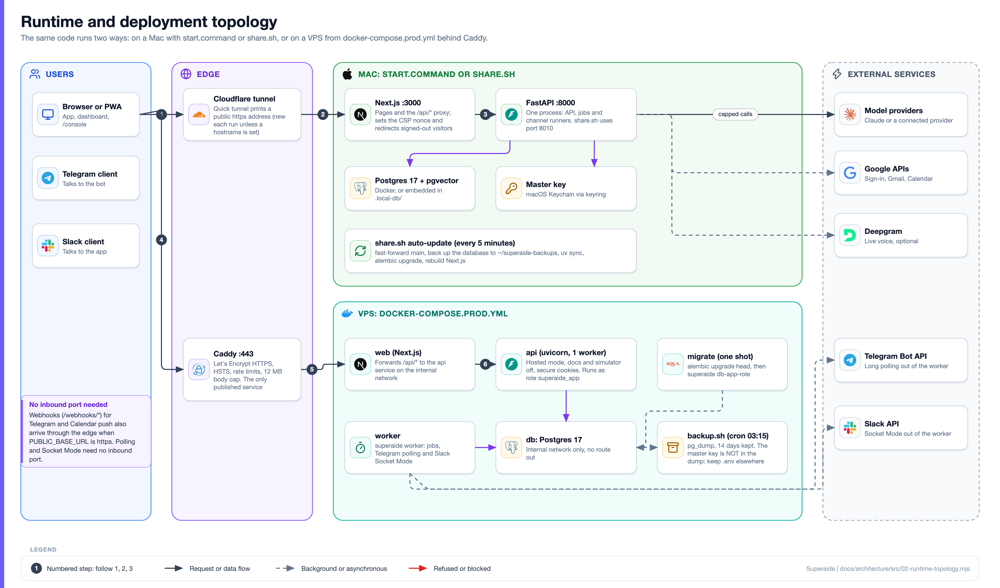
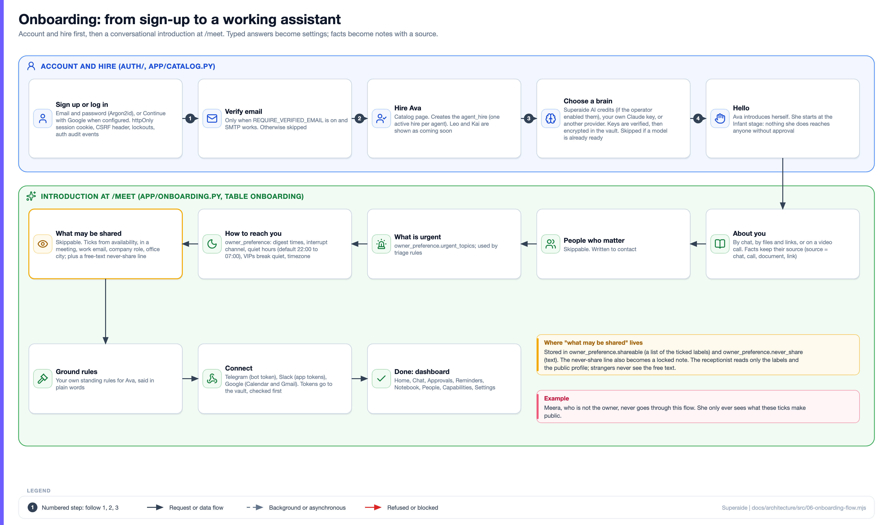
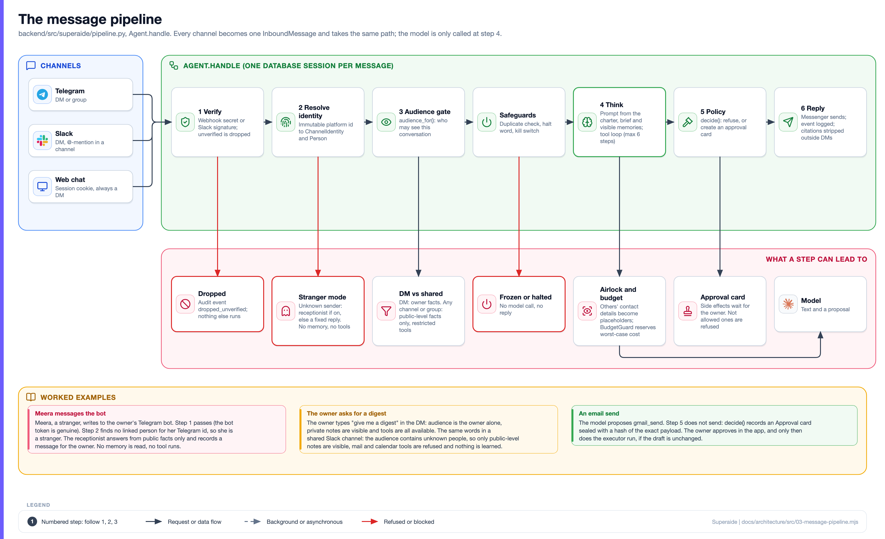
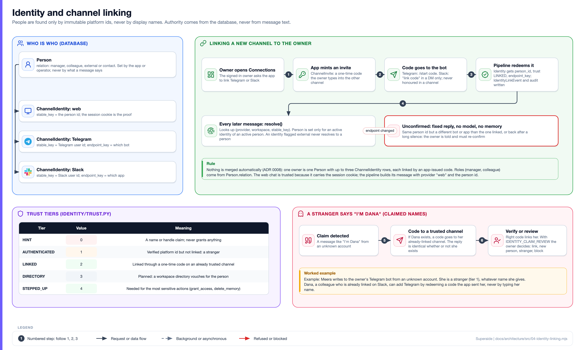
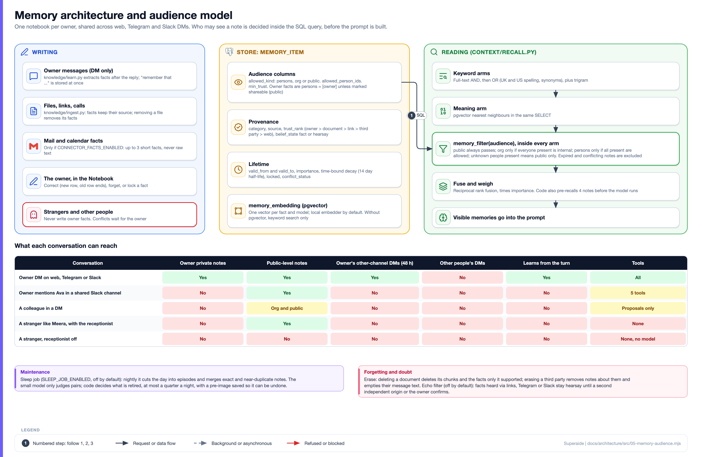
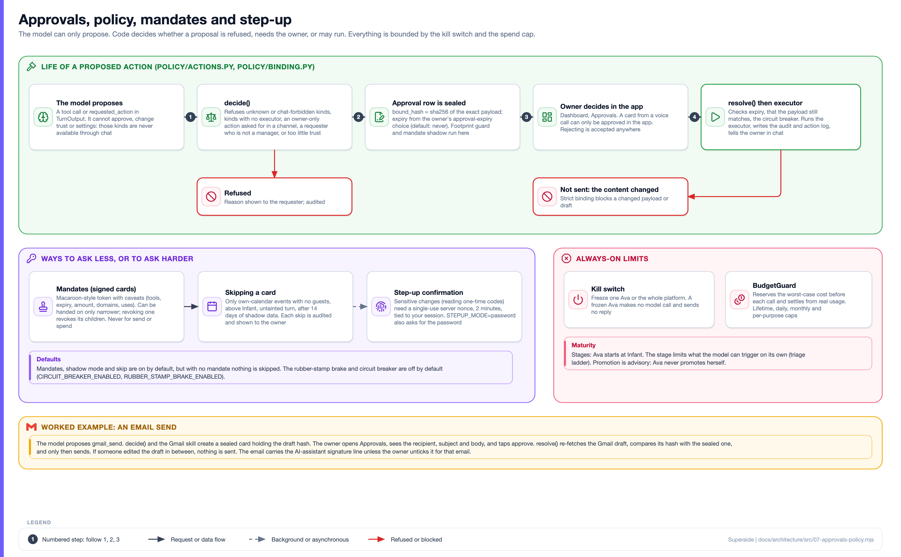
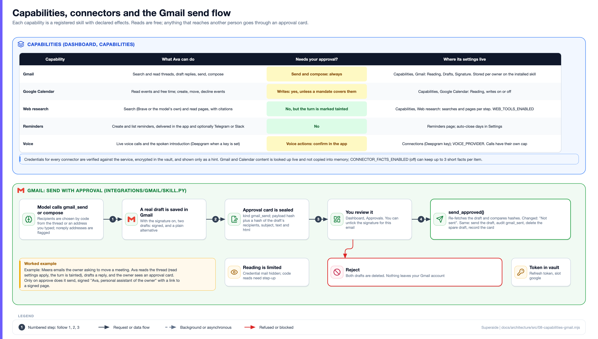
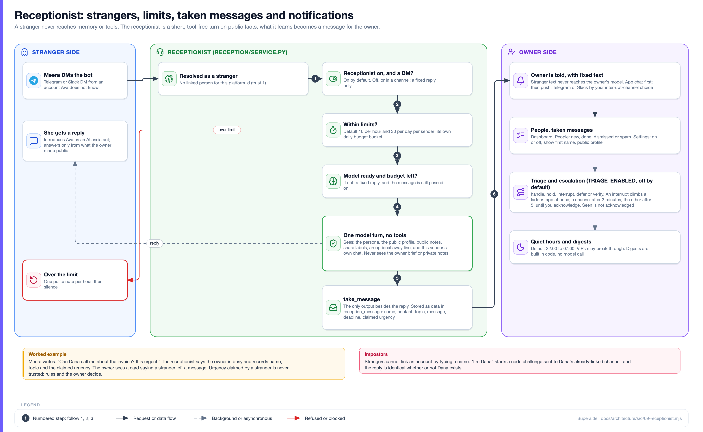
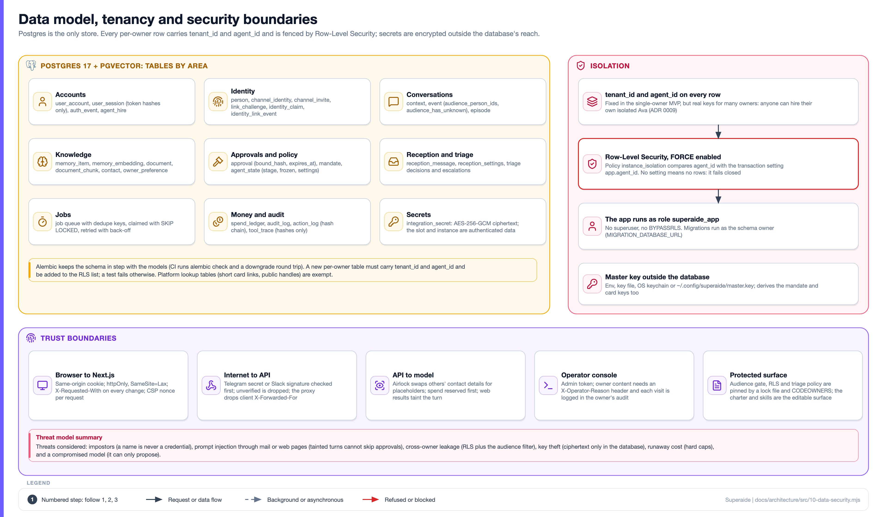
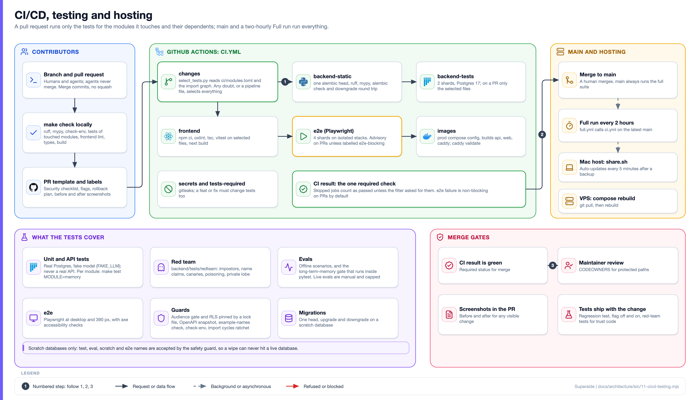

# Superaide architecture

This document explains what Superaide is, how the pieces fit together and why. It is written for a new contributor who wants the big picture, and for an advanced developer who wants code pointers. Paths are relative to the repository root; `S/` means `backend/src/superaide/`. Claims were checked against the code; anything not built is marked **Planned** with its issue number. Settings are listed in [docs/configuration.md](docs/configuration.md), decisions in [docs/decisions/](docs/decisions), research in [docs/research/](docs/research).

**Contents:** [1 The idea](#1-the-problem-and-the-idea) - [2 Tech stack](#2-tech-stack) - [3 Runtime topology](#3-runtime-topology) - [4 Onboarding](#4-onboarding) - [5 The message pipeline](#5-the-message-pipeline) - [6 Identity and linking](#6-identity-and-linking) - [7 Memory](#7-memory) - [8 Approvals, policy and limits](#8-approvals-policy-and-limits) - [9 Capabilities](#9-capabilities-and-connectors) - [10 Receptionist](#10-the-receptionist) - [11 Dashboard and console](#11-the-dashboard-and-the-operator-console) - [12 Data and tenancy](#12-data-model-and-tenancy) - [13 Jobs](#13-jobs-and-background-workers) - [14 Observability](#14-observability-and-audit) - [15 CI/CD and testing](#15-cicd-and-testing) - [16 Security](#16-security-model)

## 1. The problem and the idea

People are reached on many channels at once: a Telegram message, a Slack DM, an email. A busy person cannot answer all of them, and handing the inbox to an AI is risky: it may leak something private to the wrong person, believe an impostor, spend without limit or send something nobody approved.

Superaide is a personal assistant (the first one is **Ava**) that acts for **one owner** across the web app, Telegram and Slack. Four ideas shape everything:

1. **Decisions in code, words from the model.** Who someone is, what they may see and what may run are decided by code and the database. The model writes reply text and proposes an action (`S/brain/turn.py`, `TurnOutput`: reply, requested_action, prediction). It never writes identity, trust or memory tables.
2. **Earned autonomy.** Ava starts as an *Infant*: she watches, asks and learns, and nothing she does reaches anyone else without the owner's approval. More freedom is granted through narrow, signed, revocable mandates. Stage promotion is advisory only; Ava never promotes herself (`S/triage/promotion.py`).
3. **Privacy first.** Every memory carries an audience, and the filter runs inside the SQL query, so a note outside the audience never reaches the prompt.
4. **Hard limits.** A spend cap that reserves worst-case cost before each call, a kill switch, and approvals bound to the exact content.

*Worked story used throughout:* **Meera**, a stranger, messages the owner's Telegram bot. The owner then asks for a digest, once in a DM and once in a shared Slack channel. Finally Ava drafts an email and the owner approves its sending.

## 2. Tech stack

| Layer | Technology (versions as locked in the repo) |
| --- | --- |
| Backend | Python 3.14 managed by uv, FastAPI (JSON only), SQLAlchemy 2.1, Alembic, Pydantic 2, uvicorn, psycopg 3, Argon2 for passwords (`backend/pyproject.toml`) |
| Database | Postgres 17 with pgvector (`pgvector/pgvector:pg17`) and `pg_trgm`; Postgres is the only store ([ADR 0002](docs/decisions/0002-postgres-as-the-only-store.md)) |
| Frontend | Next.js 16 (App Router), React 19, Tailwind CSS 4, Motion, TypeScript, oxlint, vitest (`frontend/package.json`) |
| Models | Anthropic Claude by default (Haiku for chat and small jobs, Opus for deep work); other providers by preset ([ADR 0007](docs/decisions/0007-pluggable-providers.md)); local embeddings with fastembed, optional Voyage |
| Voice | Browser speech, Deepgram or ElevenLabs when a key is present ([docs/voice.md](docs/voice.md)) |
| Channels | Telegram Bot API (polling or webhook), Slack (Socket Mode), web chat; web push (PWA) |
| Google | One OAuth client for sign-in, Gmail and Calendar |
| Hosting | start.command (Mac), share.sh (Cloudflare quick tunnel), docker-compose.prod.yml with Caddy 2 (VPS) |
| Tests and CI | pytest, Playwright with axe, Ruff, mypy, GitHub Actions, gitleaks |

## 3. Runtime topology

The same code runs two ways.

- **On a Mac** (`start.command`, `share.sh`): Postgres (Docker, or an embedded one in `.local-db/` with `--no-docker`), the FastAPI process on `:8000` (`:8010` under `share.sh`) which also runs the jobs and the Telegram and Slack runners (`RUN_JOBS_IN_API`, `RUN_CHANNELS_IN_API` default true), and Next.js on `:3000`. The master key lives in the macOS Keychain. `share.sh` fast-forwards `main`, opens a Cloudflare quick tunnel and prints a public address; every five minutes it can auto-update (fast-forward merge, database backup to `~/superaide-backups`, `uv sync`, `alembic upgrade head`, rebuild).
- **On a VPS** (`docker-compose.prod.yml`, `deploy/`): `caddy` is the only published service (80, 443); `web` (Next.js), `api` (uvicorn, one worker, role `superaide_app`), `worker` (`superaide worker`: jobs plus the channel runners, so the API sets both `RUN_*_IN_API` to false), `db` (internal network only) and a one-shot `migrate` (`alembic upgrade head`, then `superaide db-app-role`). Containers are read-only with all capabilities dropped. `deploy/backup.sh` writes a `pg_dump` nightly at 03:15 and keeps 14 days; the master key is not in the dump, so keep `.env` elsewhere. There is **no server-side auto-update**: updating is `git pull` plus a compose rebuild ([deploy/README.md](deploy/README.md)).

The browser talks only to Next.js, which forwards `/api/*` to FastAPI (`frontend/src/app/api/[...path]/route.ts`), so the session cookie is first-party ([ADR 0005](docs/decisions/0005-nextjs-frontend-and-api-proxy.md)). The proxy drops client-supplied `X-Forwarded-For` unless `TRUST_PROXY_HEADERS=true`. Telegram polling and Slack Socket Mode connect outward, so no inbound port is needed; webhooks (Telegram, Calendar push) need `PUBLIC_BASE_URL` on https.

## 4. Onboarding

1. **Account.** Email and password (Argon2id) or Google sign-in (`S/auth/`, `S/integrations/google/signin.py`). Sessions are httpOnly cookies whose tokens are stored as SHA-256 hashes; state-changing requests carry `X-Requested-With` ([ADR 0003](docs/decisions/0003-cookie-sessions-and-csrf.md)). Email verification is required only with `REQUIRE_VERIFIED_EMAIL`.
2. **Hire.** The catalog (`S/app/catalog.py`) lists Ava; Leo and Kai are shown as coming soon. One active hire per agent (`agent_hire`). Anyone can hire their own isolated Ava ([ADR 0009](docs/decisions/0009-many-owners-one-ava.md)).
3. **Brain.** Superaide AI credits (only if the operator enabled `PLATFORM_AI_ENABLED`), the owner's own Claude key, or another provider (`S/app/providers.py`, `S/app/intro_brain.py`). Keys are verified against the service, then stored encrypted in the vault. The step is skipped if a model is already ready.
4. **Introduction** at `/meet` (`S/app/onboarding.py`, table `onboarding`): steps `hello, about, people, urgent, reach, share, rules, connect, done`. Typed answers become typed settings (`owner_preference`, `contact`); facts become notes with a source (`chat`, `call`, `document`, `link`).
5. **What may be shared** (`share` step). The owner ticks from `availability`, `in_meeting`, `work_email`, `company_role`, `office_city`, and may write a never-share line. Stored in `owner_preference.shareable` (list) and `owner_preference.never_share` (text); the never-share line also becomes a note. The receptionist reads only the labels and the public profile.

*Example.* The owner ticks "availability" and "company role". Later, when Meera asks "is the owner free on Friday?", the receptionist may say what the public profile and public notes allow, and nothing else.

## 5. The message pipeline

`Agent.handle` in `S/pipeline.py` takes a bounded semaphore (`max_concurrent_turns`) and runs one database session per message:

1. **Verify.** Unverified messages (bad webhook secret or Slack signature) are dropped and audited (`dropped_unverified`).
2. **Resolve identity.** `S/identity/resolver.py` maps the platform's immutable id to a `ChannelIdentity` and its `Person` (section 6).
3. **Audience gate.** `S/context/audience.py` `audience_for` decides who may see this conversation (section 7).
4. **Safeguards.** Duplicate check (unique index), halt word (`S/policy/breaker.py`, owner only), kill switch (`S/policy/killswitch.py`).
5. **Branch.** Link codes are redeemed (Telegram `/start code`; Slack `link code`, DM only). An *unconfirmed* sender (a different bot or app than the one linked, or back after a long silence) gets a fixed reply and no model. A stranger goes to the receptionist or a fixed reply (section 10). The owner goes to `_owner_turn`; other known people to `_think`.
6. **Think.** `S/brain/turn.py` builds the system prompt from `S/brain/charter.md`, the owner brief and the visible memories. `S/brain/loop.py` (`OwnerTurn`) runs up to 6 tool steps. Code recalls 4 notes before the model runs. Citations to URIs the tools did not return are dropped (`S/brain/verify.py`). The **airlock** (`S/privacy/airlock.py`, applied in `S/brain/llm.py` on every model call, `AIRLOCK_ENABLED` default true) replaces other people's contact details, ids and listed names with placeholders such as `[email 1]` and restores them in the reply. An on-device classifier is **not built**. `S/brain/budget.py` `BudgetGuard` reserves worst-case cost first.
7. **Policy.** The model's proposal goes to `S/policy/actions.py` `decide` (section 8).
8. **Reply.** The messenger sends; the event is logged; citation markers are stripped outside DMs; non-owner model replies on Telegram and Slack carry the AI-assistant line.

*Example (Meera).* Her message passes step 1 (the bot token is genuine). Step 2 finds no linked person for her Telegram id, so she is a stranger; the receptionist answers from public facts and records a message. No memory is read and no tool runs.

## 6. Identity and linking

`Person` (`S/platform/db/models.py`) is a human or agent with a `relation` (manager, colleague, external, contact) set by the app or operator, never by message text. `ChannelIdentity` is one platform account: `(provider, tenant_scope, stable_key)` is unique; `stable_key` is the immutable platform id; display names are kept only as `aux_handles`. One owner is one Person with several identities; nothing is merged automatically ([ADR 0008](docs/decisions/0008-one-ava-across-channels.md)).

Trust tiers (`S/identity/trust.py`): `HINT 0`, `AUTHENTICATED 1` (verified id, not linked: a stranger), `LINKED 2`, `DIRECTORY 3` (**Planned**, not built), `STEPPED_UP 4`.

**Linking a channel.** The owner asks the app for an invite (`ChannelInvite`), sends the one-time code to the bot (`S/app/accounts.py` `redeem_invite`), and the identity gets `person_id`, trust `LINKED` and an `endpoint_key` (which bot or app), with an `IdentityLinkEvent` and an audit line. If the same person later appears through a different bot, or after `link_reconfirm_after_days` of silence, the sender is *unconfirmed* and the owner is told. The web chat builds its message from the session (`provider "web"`).

**Claimed names.** A stranger writing "I'm Dana" starts a challenge (`S/identity/linking.py`): a salted-hash code is sent to Dana's already-linked channel, and the reply is identical whether or not Dana exists. With `IDENTITY_CLAIM_REVIEW` (off) the owner decides: link, new person, stranger or block (issue #93).

## 7. Memory

**Store.** `memory_item` (`S/platform/db/models.py`) holds the notes. Audience columns: `allowed_kind` (`persons`, `org` or `public`), `allowed_person_ids`, `min_trust`. Provenance: `category` (about, work, person, preference, urgency, availability, sharing, other), `source`, `trust_rank` (owner verified > owner document > owner link > third party > other web, `S/knowledge/trust.py`), `belief_state` (fact or hearsay). Lifetime: `valid_from`/`valid_to`, `importance`, `time_bound`, `locked`, `conflict_status`. Vectors live in `memory_embedding`, one per fact and model (pgvector; without it recall is keyword-only). Other stores: `event` (the raw log, each row carrying its audience), `episode`, `document` and `document_chunk`.

**Writing.** Facts are written by code: `remember` for "remember that ..." (owner only, DM only), and `S/knowledge/learn.py` after an owner DM reply (small model extracts, code stores via `remember_fact`; owner facts are `persons=[owner]`, or `public` if marked shareable). Files and links go through `S/knowledge/ingest.py` and keep their source; mail and calendar facts only with `CONNECTOR_FACTS_ENABLED`. Strangers and other people never write owner facts, and a weaker claim against a stronger fact waits as a conflict for the owner.

**Retrieval.** `S/context/recall.py` fuses full-text AND, full-text OR (with UK/US spelling and synonyms), trigram and a pgvector "meaning arm" by reciprocal rank fusion, weighted by importance (`S/memory/importance.py`; only time-bound facts decay, 14-day half-life). `memory_filter(audience)` is part of **every arm's SELECT**, so out-of-audience rows are never fetched. Message history is searched only when the audience has no unknown people.

**Audience rules** (`S/context/audience.py`). A known sender in a DM gets `{person}`, `has_unknown=False`. Everything else (strangers, any group or channel) gets `has_unknown=True`: only `public` rows pass. `org` passes only if everyone present is internal; `persons` only if every present person is allowed. Expired and conflicting notes are excluded. `Context.audience_class` is stored but not read by the gate.

**Shared across the owner's channels.** The unit of memory is the person, not the channel. The owner's DM audience is `{owner}` on web, Telegram and Slack, so the same notes are visible on all three, and `owner_timeline` (`S/memory/store.py`) merges the last 48 hours of the owner's own DMs from other channels into a private DM prompt, labelled such as "[On Telegram - Wed 19:13]" ([ADR 0008](docs/decisions/0008-one-ava-across-channels.md)). **Never shared:** other people's DMs, channels or threads with others, and any non-owner turn.

**Shared channels** (issue #305, built). The owner is still the owner, but the audience has unknown people, so only public-level notes are visible, history is the thread only (others' lines labelled "another person"), tools are cut to `SHARED_TOOLS` (recall, create_reminder, propose_action, web_search, web_fetch), link codes are never redeemed, and nothing is learned or journaled. Promoting a private note into a channel is **not built**.

*Example (digest).* "Give me a digest" in the owner's DM: audience `{owner}`, private notes visible, all tools, other-channel timeline included. The same words in a shared Slack channel: audience has unknown people, so only public notes, mail and calendar tools refused ("that needs a private conversation"), nothing learned. (The scheduled daily digest, `S/proactive/digest.py`, is built in code with no model call.)

**Maintenance.** The *sleep job* (`S/memory/sleep.py`, `SLEEP_JOB_ENABLED`, off): nightly episodes and tidy-up; the small model only judges pairs (`S/memory/merge.py`), code decides, at most a quarter a night, with a pre-image saved so it can be undone. *Recheck* (`MEMORY_RECHECK_ENABLED`, off) asks "is this still true?" at 30, 90, 180 and 365 days. *Echo filter* (`ECHO_FILTER_ENABLED`, off) keeps facts heard via links, Telegram or Slack as hearsay until a second independent origin or the owner confirms.

**Correction and forgetting.** Correcting ends the old row (`valid_to`) and writes a new one with source `owner_edit`; forgetting sets `valid_to`; locking pins a fact. `S/knowledge/erase.py` hard-deletes: a document with its chunks and the facts only it supported, or a third party's notes and message text (`THIRD_PARTY_MESSAGE_RETENTION_DAYS` rolls off old third-party messages; 0 = keep).

**Planned.** The proposal in [Cross channel multi party memory design](docs/research/Cross%20channel%20multi%20party%20memory%20design.md) (room rosters, disclosure engine and log, epistemic ledger, tombstones) is not built. Memory roadmap issues: [#47](https://github.com/BeastxD7/superaide/issues/47) to [#51](https://github.com/BeastxD7/superaide/issues/51); visual map [#55](https://github.com/BeastxD7/superaide/issues/55); memory passport [#56](https://github.com/BeastxD7/superaide/issues/56); memory socket for other assistants [#138](https://github.com/BeastxD7/superaide/issues/138) (flag, off).

## 8. Approvals, policy and limits

- **`decide`** (`S/policy/actions.py`) refuses kinds in `NEVER_VIA_CHAT` (change identity, trust, credentials, settings, approve, export or delete data), kinds with no executor (`APPROVAL_REQUIRE_EXECUTOR`), owner-only actions asked in a channel, requesters who are not managers, and requesters with too little trust. Otherwise it creates an `Approval` row, sealed by `S/policy/binding.py`: `bound_hash` is a sha256 of the exact payload, and `APPROVAL_BINDING=strict` (default) refuses a changed payload. Expiry comes from the owner's choice (default never; `APPROVAL_TTL_HOURS`).
- **Resolve** (`resolve` in `S/policy/actions.py`): checks expiry, binding, the circuit breaker (`CIRCUIT_BREAKER_ENABLED`, off), then runs the registered executor, writes the audit and action log and announces the outcome in chat. A card from a voice call can be approved only in the app (`S/policy/confirmation.py`).
- **Mandates** (`S/mandate/`, on by default; issue #112): macaroon-style tokens with caveats (tools, expiry, amount, domains, uses) that can only be handed on narrower; revoking one revokes its children; never for send or spend. Shadow mode records whether a mandate would have covered each approval; *skip* lets Ava add or move a calendar event with no guests without a card, only above Infant, untainted, after 14 days of shadow data, audited and shown to the owner. With no mandate nothing is skipped.
- **Step-up** (`S/auth/stepup.py`, issue #451): a single-use server nonce (2 minutes, bound to the session and action) for sensitive changes; today only `gmail_codes_read`. `STEPUP_MODE=password` also asks accounts that have a password.
- **Kill switch** (`S/policy/killswitch.py`): per instance or platform-wide; checked inside `BudgetGuard.reserve`, so a frozen Ava makes no model call. CLI `superaide freeze` / `unfreeze`.
- **Spend cap** (`S/brain/budget.py`): `reserve` runs under a per-instance advisory lock and refuses anything that could pass the lifetime (`MAX_SPEND_USD`), daily, monthly or per-purpose cap; `settle` records real usage. A model missing from `S/brain/pricing.py` is refused.
- **Other brakes (off by default):** rubber-stamp brake, footprint guard, quote odds. Stages: the stage limits what the model may trigger on its own in triage; it defaults to Infant.

*Example (email send).* Ava proposes `gmail_send`. `decide` does not send: it seals a card holding the draft hash. The owner approves; `resolve` re-fetches the draft, compares hashes and only then sends.

## 9. Capabilities and connectors

Skills are registered with declared effects (`S/skills/`, [ADR 0006](docs/decisions/0006-skill-protocol.md)). Where each lives:

| Capability | Code | Settings live in |
| --- | --- | --- |
| Gmail: search, read thread, draft, send, compose | `S/integrations/gmail/` | `installed_skill` row: Capabilities, Gmail (Reading, Drafts, Signature); [docs/settings.md](docs/settings.md); refresh token in the vault |
| Google Calendar: read, free/busy, create, move, decline | `S/integrations/calendar/` | Capabilities, Calendar; push via `GOOGLE_CALENDAR_PUSH` (off) |
| Web research: search (Brave or model-native) and fetch, with citations and SSRF guards | `S/tools/web.py` | `WEB_TOOLS_ENABLED` (on), Capabilities, Web research; a turn that read the web is *tainted* |
| Reminders | `S/intentions/` | Reminders page; auto-close days in Settings |
| Voice | `S/features/voice/` | `VOICE_PROVIDER` (on when a Deepgram key is present); calls have their own cap |

**Gmail send flow:** the model calls `gmail_send`/`gmail_compose`; recipients are chosen by code; a real draft is saved in Gmail (two when the signature is on); an approval card is sealed with a hash of the draft's recipients, thread, subject, text and html; the owner reviews it under Approvals; `send_approved` re-fetches the draft and compares hashes (changed means "Not sent"), sends, audits `gmail_sent` and deletes the spare draft; a rejection deletes the drafts. Emails carry an honest AI-assistant signature with a link to a signed public page (`S/principal/`, [docs/principal-card.md](docs/principal-card.md)); the owner can untick it per email. Reading hides credential mail and limits previews; reading one-time codes needs step-up. Calendar and Gmail content is looked up live, not copied into memory.

## 10. The receptionist

For a DM on Telegram or Slack from an account Ava does not know (`S/reception/service.py`): a linking code goes to the linking flow; if the receptionist is off or the message is in a channel, a fixed reply; an "I'm <name>" claim starts the challenge; over the limit (default 10 an hour, 30 a day per sender) one polite note an hour, then silence; with no owner-paid model or an exhausted `receptionist` budget bucket (US$0.10 a day) a fixed reply and the message is still passed on; otherwise one model turn (`S/reception/turn.py`, `S/brain/receptionist.md`). That turn sees only the persona, the public profile, public notes, share labels, an optional away line and the sender's own chat. It has no tools and no memory writes; its only extra output is `take_message`, stored as data in `reception_message`. The owner's chat and pushes get fixed text only, so stranger text never reaches the owner's model. The receptionist is **on by default** (`ReceptionSettings.enabled`).

**Notifications and triage.** `S/proactive/notify.py` writes to the app chat first, then Telegram or Slack by the owner's interrupt channel; web push is the app rung ([ADR 0011](docs/decisions/0011-mobile.md)). With `TRIAGE_ENABLED` (off; [ADR 0010](docs/decisions/0010-triage-and-escalation.md)) each non-owner message gets a decision (handle, hold, interrupt, defer, verify) and an interrupt climbs a ladder: app at once, a channel after 3 minutes, the other after 5, until acknowledged; "seen" is never an acknowledgement. The phone rung is **not built**. Quiet hours default to 22:00 to 07:00; digests are built in code.

## 11. The dashboard and the operator console

The owner's dashboard (`frontend/src/app/(site)/dashboard/`, navigation in `frontend/src/features/dashboard/nav.ts`): Home, Chat, Needs you (triage only), Approvals, Reminders, Notebook, Learning, People, Capabilities, Connections, AI model, Settings. Public pages: agent profiles, `/c/<token>` signed-card pages, `/a/<handle>` (off). The **operator console** (`/console`, `S/api/admin.py`) uses a bearer `ADMIN_TOKEN`: overview, spend, people, conversations, safety log, kill switch and an impostor simulator (`ENABLE_SIMULATOR`, development only). Reading owner content needs an `X-Operator-Reason` header and each visit is written to the owner's audit ([ADR 0009](docs/decisions/0009-many-owners-one-ava.md)).

## 12. Data model and tenancy

Tables by area: accounts (`user_account`, `user_session`, `agent_hire`), identity (`person`, `channel_identity`, `channel_invite`, `link_challenge`, `identity_claim`), conversations (`context`, `event`, `episode`), knowledge (`memory_item`, `memory_embedding`, `document`, `contact`, `owner_preference`), approvals (`approval`, `mandate`, `agent_state`), reception, money and audit (`spend_ledger`, `audit_log`, `action_log`, `tool_trace`), `job`, and `integration_secret`. Migrations are in `backend/alembic/`; CI runs `alembic check` and a downgrade round trip, and because tests build their schema from the models, a model change also needs a matching Alembic revision.

**Tenancy.** Every per-owner row carries `tenant_id` and `agent_id`, stamped from the `InstanceScope` (`S/platform/tenancy/`). **Row-Level Security** (`S/platform/db/rls.py`): policy `instance_isolation` compares `agent_id` with the transaction setting `app.agent_id`; with no setting nothing is visible, and `FORCE` applies it to the owner. The app connects as `superaide_app` (no superuser, no BYPASSRLS); migrations run as the schema owner. A test fails if a new per-owner table is not in the RLS list. **Vault** (`S/vault/`, [ADR 0004](docs/decisions/0004-credentials-vault.md)): AES-256-GCM, authenticated data binds the slot and instance; the master key comes from `SECRETS_MASTER_KEY`, `SECRETS_MASTER_KEY_FILE`, the OS keychain or `~/.config/superaide/master.key`, never from the database. Credentials are verified with their service before saving and shown only as hints.

## 13. Jobs and background workers

Background work is rows in the `job` table (`S/jobs/`): `enqueue(..., dedupe_key, run_at)`, claimed with `FOR UPDATE SKIP LOCKED` fairly across instances, retried with exponential back-off, run inside the owner's `InstanceScope`; handlers must be idempotent. Kinds include `deliver_intention`, `send_digest`, `learn_from_turn`, `read_pending`, `embed_memories`, `gmail_poll`, `renew_calendar_watch`, `scan_meetings`, `meeting_prep`, `sleep_consolidate`, `triage_inbound`, `escalation_step`. `JobWorker` re-books recurring work every 5 minutes and sweeps pending documents every 10. In development the API runs jobs and channel runners in-process; in production `superaide worker` does (one Telegram or Slack listener per bot via a Postgres advisory lock). Failures are shown to the owner rather than swallowed.

## 14. Observability and audit

`audit_log` and `account_audit` (`S/platform/audit.py`) are append-only and carry counts and ids, never message text. `action_log` (`S/actionlog/`) is a hash chain of tool calls and executed approvals (`ACTION_LOG`, off); `superaide witness` checks it. `tool_trace` records hashes only (`TRACE_RECORDER`, on). The operator Safety log page, the `spend` CLI, a request id in every error envelope ([ADR 0013](docs/decisions/0013-standard-api-response.md)) and log redaction (`S/platform/security/logredact.py`) complete the picture.

## 15. CI/CD and testing

`.github/workflows/ci.yml`: `changes` (module-wise selection by `scripts/select_tests.py` from `ci/modules.toml` and the import graph; any doubt selects everything), `backend-static` (one alembic head, ruff, mypy, alembic check, downgrade round trip), `backend-tests` (2 shards, selected files on a PR), `frontend`, `e2e` (4 Playwright shards; **advisory on PRs** unless labelled `e2e-blocking`, always blocking on main), `images`, `secrets` (gitleaks), `tests-required`, and the single required check `CI result`. `main` always runs the full suite, and `full.yml` runs it every two hours. Tests use a real Postgres and a fake model (`FAKE_LLM`); they never call a real API and only touch databases whose name contains `test`, `eval`, `scratch` or `e2e`. Suites: unit and API per module (`make test MODULE=memory`), `backend/tests/redteam` (impostors, name claims, canaries, poisoning), evals (`make eval`, the long-term-memory gate runs inside pytest; live evals are manual and capped), guards (surface lock, OpenAPI snapshot, example names, import-cycle ratchet), and Playwright at desktop and 390 px. See [CONTRIBUTING.md](CONTRIBUTING.md) and [AGENTS.md](AGENTS.md).

## 16. Security model

Summary of the threat model (details in [SECURITY.md](SECURITY.md) and the diagram above):

| Threat | Defence |
| --- | --- |
| Impostor (a name, a claimed role) | People resolve by immutable ids; authority from the database; link needs a one-time code on a trusted channel; claimed names start a challenge with an indistinguishable reply |
| Leak to the wrong audience | Audience filter inside the SQL; shared channels see public-level notes only; the receptionist has no tools and only public facts; airlock placeholders before model calls |
| Prompt injection (mail, web, files) | The model only proposes; tainted turns cannot skip approvals; `NEVER_VIA_CHAT` kinds; approvals bound to exact content |
| Cross-owner leakage | `tenant_id`/`agent_id` on every row, RLS fail-closed, non-superuser app role |
| Key theft | Ciphertext only in the database; master key outside it; hints only in the UI |
| Runaway cost | Reservation before each call; lifetime, daily, monthly and per-purpose caps; kill switch |
| Compromised or confused model | It cannot write identity, trust or memory tables; protected files are pinned by `S/platform/security/surface.lock.json` and CODEOWNERS |
| Web attacks | httpOnly SameSite cookies, CSRF header, per-request CSP nonce, rate limits at Caddy, SSRF guards on fetches |

**Not done (Planned):** trust tier DIRECTORY, a phone escalation rung, an on-device airlock classifier, server-side auto-update, promoting private notes into channels, and the cross-channel disclosure engine. Roadmap issues are tracked in the [issue list](https://github.com/BeastxD7/superaide/issues) (for example [#110](https://github.com/BeastxD7/superaide/issues/110) to [#116](https://github.com/BeastxD7/superaide/issues/116) trust and audit, [#129](https://github.com/BeastxD7/superaide/issues/129) to [#132](https://github.com/BeastxD7/superaide/issues/132) skill marketplace).

## Regenerating the diagrams

Sources are in `docs/architecture/src/` (one `NN-name.mjs` per diagram, built with the small library `lib.mjs`; icons are vendored in `icons.json`). `node docs/architecture/render.mjs` writes the SVG and PNG files with Playwright (needs `npm ci` in `e2e/`); `node docs/architecture/build-icons.mjs` refreshes `icons.json` from `simple-icons` and `lucide-react`.
