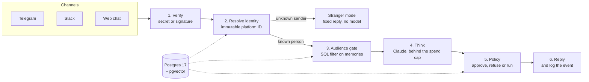

<p align="center">
  
</p>

<p align="center">
  <a href="https://github.com/BeastxD7/superaide/actions/workflows/ci.yml"></a>
  
  
  
  
  
  
</p>

<p align="center">
  <a href="#quick-start">Quick start</a> &middot;
  <a href="#why-superaide">Why</a> &middot;
  <a href="#what-it-does">Features</a> &middot;
  <a href="#how-it-works">Architecture</a> &middot;
  <a href="#safety-model">Safety</a> &middot;
  <a href="#configuration-and-feature-flags">Configuration</a> &middot;
  <a href="#documentation">Docs</a> &middot;
  <a href="#roadmap">Roadmap</a>
</p>

# Superaide

**AI assistants you hire, who work for you across your chat channels.** The first one is **Ava**. When you are busy she answers the people who reach out, within what you have allowed. She takes a proper message when she cannot answer, and she interrupts you only for what you said is urgent.

Ava starts at the **Infant** stage: she watches, asks and learns, and nothing she does reaches anyone else without your approval. She talks to you in the web app, Telegram and Slack, recognises who she is talking to, and refuses impostors. She keeps private things private and cannot spend more than the cap you set on Claude API credit (US$10 by default).

> **Status:** early. This is phase 1 (channels, identity, audience-scoped memory, policy, the spend cap, accounts, the introduction and an operator console). Newer features ship behind flags that are **off by default**; see the [Roadmap](#roadmap) for which.

<p align="center">
  
</p>

## Why Superaide

| | |
| --- | --- |
|  | **Earned autonomy.** Every agent starts as a beginner (Infant, then Child, Adolescent, Adult). It takes on more only when it has earned it, and side effects need your approval. |
|  | **Privacy decided in code.** Who someone is, what they may see and what may run are decided by code and the database. The model writes reply text and proposes an action; it never writes identity, trust or memory tables. |
|  | **Audience-scoped memory.** Every memory carries an audience, and the filter runs inside the SQL query, so something out of audience never reaches the prompt. |
|  | **A hard spend cap.** Each Claude call reserves its worst-case price first and is refused if it could pass the cap. Bring your own AI key (any provider), or opt in to capped Superaide credits. |
|  | **Reliability first.** Background work runs as retried jobs in Postgres, and failures are shown to the owner instead of swallowed. |
|  | **Many owners, one product.** Anyone can hire their own Ava. Each owner's data is isolated (tenant and instance ids on every row, Row-Level Security). |

## What it does

<table>
  <tr>
    <td width="50%"><br/><b>An introduction, the way a new assistant would.</b> Eight short steps: about you, the people who matter, what is urgent, quiet hours, what may be shared, ground rules, connections.</td>
    <td width="50%"><br/><b>Learn from a file, a link or a video call.</b> Facts keep their source. Removing a file removes what was learned from it.</td>
  </tr>
  <tr>
    <td><br/><b>Memory with sources.</b> An answer can cite the notebook entry it came from. (This capture is a mocked reply in offline mode; see the note below.)</td>
    <td><br/><b>Dashboard.</b> Her stage, where people reach her, what she knows, who always gets through and your rules.</td>
  </tr>
  <tr>
    <td><br/><b>A notebook you can read.</b> Each fact has a category and where it came from.</td>
    <td><br/><b>A receptionist for strangers.</b> Unknown senders get a fixed reply, or a limited receptionist you switch on that shares only what you marked public.</td>
  </tr>
  <tr>
    <td><br/><b>Your AI, your key.</b> Pick a provider on the AI model page. Each key is checked with the service, encrypted and shown only as a hint.</td>
    <td><br/><b>Connections, in the app.</b> Telegram, Slack and Google Calendar, without editing files.</td>
  </tr>
  <tr>
    <td><br/><b>Capabilities.</b> The skills Ava can use, and what each is allowed to do.</td>
    <td align="center"> <br/><b>Phone-sized screens</b> work too.</td>
  </tr>
</table>

All screenshots are taken from the running app with a fake test owner and the offline model (no real data, nothing spent). With no AI model connected Ava answers with placeholders; connect one on the **AI model** page to switch her on.

**Channels and identity**
- Telegram, Slack and the in-app web chat, normalised to one message type. Unverified webhooks and bad Slack signatures are dropped.
- People are recognised by immutable platform IDs, never display names. Unknown senders get stranger mode: a fixed reply, no memory, no model call (unless you switch the receptionist on).
- A new channel is linked only with a one-time code sent to a channel you already trust.

**Memory and knowledge**
- Typed settings (contacts, preferences) plus a notebook of sourced facts; the owner brief is scoped to who is asking.
- Reminders and approvals in the app; Google Calendar as a connection.
- Gmail inbox triage and the triage and escalation pipeline exist but are **off by default** (`GMAIL_TRIAGE_ENABLED`, `TRIAGE_ENABLED`, see [ADR 0010](docs/decisions/0010-triage-and-escalation.md)).
- A video-call introduction, where Ava speaks and your browser transcribes. A second voice pipeline (v2) is behind `VOICE_INTRO_V2`, off by default ([ADR 0012](docs/decisions/0012-voice-intro.md)).

**Operations**
- An operator console at `/console`: people and trust tiers, conversations, a safety log, spend, a pause switch and an impostor simulator.
- A kill switch that stops all model calls, and a CLI (`uv run superaide --help`).

## Quick start

**On a Mac, no setup:** double-click `start.command`, or run:

```bash
bash start.command
```

It installs [uv](https://docs.astral.sh/uv/) and, if Node.js 20.9+ is missing, a private checksum-verified Node in `.tools/`. It starts Postgres (Docker if installed, else an embedded one), then the API and the frontend, and opens http://localhost:3000. Without an AI key Ava runs in offline mode and nothing is spent. `--reset` wipes the data first; `--no-docker` forces the embedded Postgres.

**For development** you need [uv](https://docs.astral.sh/uv/), Node 24 (22 also works) and Docker:

```bash
make setup                         # backend, frontend and e2e dependencies, git hooks
cp backend/.env.example backend/.env
make db migrate                    # Postgres 17 + pgvector in Docker, then the tables
make api                           # terminal 1: API with auto-reload on :8000
make web                           # terminal 2: Next.js frontend on :3000
```

`make` lists every command, and `make stack` runs the whole stack in containers. To reach the app from a phone or through a tunnel (for example a Cloudflare quick tunnel), add the public address to `LINK_ORIGINS` (the example in [`backend/.env.example`](backend/.env.example) is `https://*.trycloudflare.com`) so links in emails use it. **On a server:** `sudo bash deploy/bootstrap.sh your-domain` puts the app on a VPS with HTTPS ([deploy/README.md](deploy/README.md)).

## How it works

Everything about **who** someone is, **what** they may see and **what** may run is decided in code. The model only writes reply text and proposes an action.



| Part | Stack | Runs on |
| --- | --- | --- |
| [`frontend/`](frontend) | Next.js 16 (App Router), React 19, Tailwind CSS 4, Motion | http://localhost:3000 |
| [`backend/`](backend) | Python 3.14, FastAPI (JSON only), SQLAlchemy 2, Alembic, Claude | http://127.0.0.1:8000 (`/docs`) |
| Database | Postgres 17 with pgvector | localhost:5432 |

The browser talks only to the Next.js server, which forwards `/api/*` to FastAPI, so the session cookie always belongs to the app's own origin ([ADR 0005](docs/decisions/0005-nextjs-frontend-and-api-proxy.md)). Telegram and Slack connect to the backend directly. More in [docs/architecture.md](docs/architecture.md).

## Safety model

| Decided in code (never by the model) | Decided by the model |
| --- | --- |
| Who someone is (platform ID lookup) and their trust tier | The wording of a reply |
| Which memories the sender may see (SQL audience filter) | Which action to propose, if any |
| Whether an action runs, needs approval or is refused | A short prediction attached to the turn |
| How much may be spent, and the kill switch | Which facts to extract from a file you share |
| Linking a new channel (one-time code to a trusted channel) | |

- Credentials are verified with their service, encrypted with AES-256-GCM and shown only as hints.
- Accounts use Argon2id, httpOnly cookie sessions, CSRF protection, lockouts and an audit trail.
- New features ship behind flags that default to **off** (see [Configuration and feature flags](#configuration-and-feature-flags)).
- The impostor scenarios live in `backend/tests/redteam`. Report vulnerabilities as described in [SECURITY.md](SECURITY.md).

## Configuration and feature flags

Every setting is an environment variable. [`backend/.env.example`](backend/.env.example) lists all of them, once each, with what it does, the accepted values, the default and whether it is a secret; its top is an index of every true/false switch. A check (`make check-env`, also run by the tests and pre-commit) fails when a setting is added to the code without being documented there.

### Set up

1. **Backend:** `cp backend/.env.example backend/.env` (`start.command` does this for you and fills in `ADMIN_TOKEN`). The file lives next to the code the API runs from, `backend/`. Never commit it; it is git-ignored.
2. **Frontend** (only if you change anything): `frontend/.env.example` to `frontend/.env.local`. Variables starting `NEXT_PUBLIC_` are baked in at build time, so rebuild after changing them.
3. **Restart** the API (and the worker, if you run one) after every change. Environment variables win over `backend/.env`; keys connected in the app (Workspace, Connections) win over both.
4. A line `# NAME=value` is commented out and shows the built-in default: uncomment it only to change it. `true`/`false` are the only boolean spellings you need.
5. `SECRETS_MASTER_KEY`, `SECRETS_MASTER_KEY_FILE` and `SUPERAIDE_KEY_FILE` are read from the process environment only, not from `backend/.env`. On a Mac leave them unset (the Keychain holds the key).
6. **Production** uses `.env.prod.example` at the repository root, see [Production differences](#production-differences).

### Flags at a glance

**Safe to turn on yourself:** bounded cost, no data leaves your server, nothing irreversible. **Owner decision:** it spends money, sends data to another company, makes something public, or widens what Ava may do without asking; decide on purpose. Every flag defaults to the value shown.

| Variable | Default | Turns on | Extra setup | Verdict |
| --- | --- | --- | --- | --- |
| `MAIL_LOG_BODY` | `true` | With `MAIL_BACKEND=log`, the whole email (live verification and reset links) goes to the API log; `false` logs only recipient and subject | `MAIL_BACKEND=log` | Safe (set `false` anywhere logs are shared) |
| `WEB_TOOLS_ENABLED` | `true` | Ava searches and reads the web (about US$0.01 a search from the research budget) | Optional `BRAVE_SEARCH_API_KEY` for models with no built-in search | Safe |
| `TRACE_RECORDER` | `true` | Hashes-only record of every tool call | None | Safe |
| `ENABLE_API_DOCS` | `true` | Interactive API docs at `/docs` | Turn off on a public server (production compose does) | Safe locally |
| `RUN_CHANNELS_IN_API` | `true` | Telegram and Slack listeners inside the API | `false` when a separate worker runs them (production compose) | Safe |
| `RUN_JOBS_IN_API` | `true` | Reminders, follow-ups, digests inside the API | `false` when a separate worker runs them | Safe |
| `ALLOW_MANY_OWNERS` | `true` | Anyone who signs up can hire their own Ava | `false` = single-owner mode | Decision (sign-up policy) |
| `ENABLE_SIMULATOR` | `false` (example: `true`) | Operator console impostor simulator | `ADMIN_TOKEN`; development only | Never on a public server |
| `FAKE_LLM` | `false` | Offline echo replies, nothing spent | None | Safe (for demos) |
| `TRIAGE_ENABLED` | `false` | A recorded handle/hold/interrupt/defer/verify decision for every non-owner message; interrupts escalate to the owner | None | Safe |
| `TRIAGE_KNN_ENABLED` | `false` | Shadow urgency score from your own feedback beside each triage decision; never changes a decision | `TRIAGE_ENABLED=true` | Safe |
| `GMAIL_TRIAGE_ENABLED` | `false` | Polls each owner's Gmail inbox and triages new mail | `TRIAGE_ENABLED=true`, Google client, owner signs in to Gmail; `GMAIL_POLL_MINUTES` | Decision (reads mail) |
| `CONNECTOR_FACTS_ENABLED` | `false` | Up to 3 short facts per calendar event or verified email kept as notes (never the raw text); disconnecting deletes them | Gmail and/or Calendar connected; `CONNECTOR_FACTS_PER_DAY` (20) | Decision (what is remembered from mail) |
| `GOOGLE_SIGNIN_ENABLED` | `false` | "Continue with Google" on log-in and sign-up | `GOOGLE_CLIENT_ID` + `GOOGLE_CLIENT_SECRET`, redirect URI registered | Safe |
| `GOOGLE_CALENDAR_PUSH` | `false` | Google tells the server when the calendar changes | `PUBLIC_BASE_URL` on https with `/webhooks/*` reachable | Safe |
| `PUSH_ENABLED` | `false` | Web push to the owner's phone (makes a VAPID key pair on first use) | Real `VAPID_SUBJECT`; https | Safe |
| `ECHO_FILTER_ENABLED` | `false` | Facts heard via links, Telegram or Slack stay hearsay until a second independent origin or the owner confirms | None | Safe |
| `ONE_GOOD_QUESTION_ENABLED` | `false` | At most one clarifying question to the owner a day | None | Safe |
| `SECOND_OPINION_ENABLED` | `false` | Memory-free second view on the owner's own claims (up to 2 small-model calls per message) | Model key; `AGREEMENT_LIMIT` | Safe (small cost) |
| `WHY_REPLAY_ENABLED` | `false` | "Why did you say that?" replay (up to `REPLAY_MAX_ABLATIONS` + 1 small-model calls) | Model key | Safe (small cost) |
| `OWNER_TWIN_ENABLED` | `false` | Calibration page for a predictor of the owner's approve/reject choices | None | Safe |
| `SKILL_RATCHET_ENABLED` | `false` | Ava drafts playbooks; only owner-edited ones go live, at most 50 | None | Safe |
| `OVERNIGHT_TUNER_ENABLED` | `false` | Proposes a better triage prompt; the owner approves or rolls back | `TRIAGE_ENABLED=true`, model key | Safe |
| `REHEARSAL_ENABLED` | `false` | Practise a hard conversation with Ava as the other side; nothing is sent | Model key | Safe |
| `SCHOOL_ENABLED` | `false` | Write, consent to and export generic lessons, or import a file; local only | None | Safe |
| `RELATIONSHIP_SAFETY_ENABLED` | `false` | Fixed human-written replies for heavy or "do you love me?" owner messages; no claims of feelings | None | Safe |
| `RUBBER_STAMP_BRAKE_ENABLED` | `false` | Adds friction to fast always-yes approvals (typed reason on high-risk cards) | None | Safe (only adds friction) |
| `MEMORY_RECHECK_ENABLED` | `false` | Digest may ask "is this still true?" about a few lasting facts | `MEMORY_RECHECK_PER_WEEK` | Safe |
| `SLEEP_JOB_ENABLED` | `false` | Nightly episodes and removal of exact duplicate notes (at most a quarter a night, pre-image saved) | `SLEEP_JOB_HOUR`; the jobs run (`RUN_JOBS_IN_API` or worker) | Decision (edits memory) |
| `VOICE_INTRO_V2` | `false` | Conversational voice interview in the introduction call | Free with browser speech; better voices need Deepgram/ElevenLabs keys | Safe |
| `SURFACE_CHECK_ON_BOOT` | `false` | Refuses to start if a protected file differs from `security/surface.lock.json` | Lock file kept current | Safe, but can block start-up |
| `ACTION_LOG` | `false` | Hash-chained log of tool calls and executed approvals | None | Safe |
| `PLATFORM_AI_ENABLED` | `false` | Owners may use the server's own Claude key as "Superaide AI credits" | `PLATFORM_ANTHROPIC_API_KEY` (or `ANTHROPIC_API_KEY`), `PLATFORM_DAILY_CAP_USD` above 0, per-owner limits | **Decision (costs you money)** |
| `ASK_LINK_ENABLED` | `false` | Public `/a/<handle>` intake pages | `ASK_FORM_SECRET`; rate-limit settings | **Decision (public page)** |
| `IMPORT_LEASE_ENABLED` | `false` | Import context cards from a third-party export under a time-limited lease | None | Decision (imports personal data) |
| `AIRLOCK_ENABLED` | `false` | Contact details, cards and ID-like numbers become placeholders before a model call | None (the on-device model is not built) | Decision (changes every prompt) |
| `CIRCUIT_BREAKER_ENABLED` | `false` | Too many deletes or sends in a window freeze Ava; the owner's `HALT_WORD` freezes her at once | `CIRCUIT_BREAKER_LIMIT` (5), `CIRCUIT_BREAKER_WINDOW_SECONDS` (60), `HALT_WORD` | Decision (can pause Ava) |
| `FOOTPRINT_GUARD_ENABLED` | `false` | Creating accounts, profiles or public posts under the owner's name always needs approval; unknown names are flagged | None | Decision (more approvals) |
| `PRINCIPAL_CARD_ENABLED` | `false` | Outbound Gmail replies carry an honest AI line and a signed public page | Owner display name; `PRINCIPAL_CARD_DAYS` | **Decision (public page, changes outgoing mail)** |
| `MANDATES_ENABLED` | `false` | Signed, narrowing mandate cards let Ava do a named limited thing without asking (never send or spend) | None | **Decision (reduces approvals)** |
| `MCP_PINNING` | `false` | Blocks an MCP tool whose description, schema or annotations changed since approval | Has no effect until an MCP client exists | Safe |
| `MEMORY_SOCKET_ENABLED` | `false` | Read-only MCP endpoint `POST /mcp/memory` for the owner's other assistants | One token per consumer created by the owner; `MEMORY_SOCKET_PER_MINUTE` | **Decision (exposes memory to other tools)** |
| `DISSENT_DESK_ENABLED` | `false` | Three different models answer high-stakes choices | `DISSENT_MODELS` (comma-separated ids), `DISSENT_MIN_STAKES`; budget bucket `dissent` | Decision (cost; other vendors) |
| `FORK_NIGHT_ENABLED` | `false` | Three overnight drafts of a choice the owner leaves | `FORK_NIGHT_HOUR`; model key; bucket `fork` | Decision (cost) |
| `TIME_TRAVEL_RULES_ENABLED` | `false` | Plain-words standing orders compiled to rules, replayed on past messages, shadow-run first | `TIME_TRAVEL_REPLAY_DAYS`, `TIME_TRAVEL_PROMOTE_AFTER`, `TIME_TRAVEL_MIN_AGREEMENT`; bucket `rules` | Decision (automates replies) |
| `QUOTE_ODDS_ENABLED` | `false` | Approval cards show honest odds; low-odds approvals prepare instead of run | `QUOTE_MIN_SAMPLES`, `QUOTE_MIN_SUCCESS` | Decision (changes what approve does) |
| `VOICE_TWO_CHANNEL` | `false` | A voice-call action becomes an approval only a text-channel tap can approve | A text channel connected | Safe (stricter) |
| `REQUIRE_VERIFIED_EMAIL` | `false` | Hiring needs a confirmed email | `MAIL_BACKEND=smtp` working first | Decision (locks out until mail works) |
| `SESSION_COOKIE_SECURE` | `false` | Session cookie only over HTTPS | Must be `true` on any https site (production compose forces it) | Safe |
| `ALLOW_UNSAFE_PUBLIC_SELF_HOSTED` | `false` | Overrides the startup refusal of a public, open-sign-up, self-hosted server | None | Do not |

Not booleans but switches: `APPROVAL_BINDING` (`off` / `record` / `strict`, default `record`; `strict` blocks a send whose content changed after the owner saw it), `APPROVAL_TTL_HOURS` (0 = approvals never expire), `EMBEDDER` (`local` / `voyage` / `fake` / `none`; `voyage` sends private facts to Voyage AI), `DEPLOY_MODE` (`self_hosted` / `hosted`), `MAIL_BACKEND` (`log` / `smtp`), `VOICE_ASR` and `VOICE_TTS`, `THIRD_PARTY_MESSAGE_RETENTION_DAYS` (0 = keep forever).

### How to enable

**Models and keys.** Set `ANTHROPIC_API_KEY` (or let each owner connect their own in Workspace, Connections) and Ava replies for real; without a key she runs offline and spends nothing. `MODEL_CHAT`, `MODEL_TRIAGE`, `MODEL_DEEP` choose models; a model missing from `brain/pricing.py` is refused. Spend is capped by `MAX_SPEND_USD` (lifetime), `BUDGET_DAILY_USD`, `BUDGET_MONTHLY_USD` and `BUDGET_DAILY_BY_BUCKET`, per Ava. Other providers (Ollama, OpenAI-compatible, and so on) are connected in the app, then used as `<preset>::<model>`; on `DEPLOY_MODE=hosted` owner-typed private addresses are refused.

**Google sign-in, Calendar and Gmail.** One OAuth client of type "Web application" serves all three.
1. In Google Cloud enable the Google Calendar API and the Gmail API, and add the scopes `calendar.readonly`, `calendar.events`, `gmail.readonly`, `gmail.compose`.
2. Register redirect URIs `<FRONTEND_ORIGIN>/api/auth/google/callback` (sign-in) and `<FRONTEND_ORIGIN>/api/app/connections/google/callback` (Calendar). Other origins you use go in `GOOGLE_REDIRECT_ORIGINS` and must also be allowed by `LINK_ORIGINS` or `DEV_ORIGINS`.
3. Set `GOOGLE_CLIENT_ID` and `GOOGLE_CLIENT_SECRET`, then `GOOGLE_SIGNIN_ENABLED=true` for sign-in. Calendar and Gmail need no flag for chat use: the owner clicks Connect Google in Connections and the token goes to their vault.
4. Gmail triage: also `TRIAGE_ENABLED=true` and `GMAIL_TRIAGE_ENABLED=true`. Calendar push: `PUBLIC_BASE_URL=https://...` with `/webhooks/*` routed to the API, then `GOOGLE_CALENDAR_PUSH=true`.

**Telegram.** Create a bot with @BotFather and connect the token in the app, or set `TELEGRAM_BOT_TOKEN`. Polling needs nothing else. For webhooks set `TELEGRAM_WEBHOOK_BASE_URL` (or `PUBLIC_BASE_URL`) to your https address and route `/webhooks/*`; `TELEGRAM_WEBHOOK_SECRET` is for the single env-configured bot.

**Slack.** Create the app from [`slack_manifest.yml`](backend/src/superaide/channels/slack_manifest.yml) (Socket Mode), then connect it in the app or set `SLACK_BOT_TOKEN` (`xoxb-`), `SLACK_APP_TOKEN` (`xapp-`), `SLACK_SIGNING_SECRET` and `SLACK_TEAM_ID` (people from other workspaces count as external).

**Email (SMTP).** `MAIL_BACKEND=smtp`, `MAIL_FROM`, `SMTP_HOST`, `SMTP_PORT`, `SMTP_USERNAME`, `SMTP_PASSWORD`, `SMTP_SECURITY` (`starttls` / `ssl` / `none`). Then `REQUIRE_VERIFIED_EMAIL=true` if hiring should need a confirmed address. `MAIL_BACKEND=log` (the default) writes each email, **including live verification and password-reset links**, to the API log: fine on your own machine, never on a shared or public server.

**Many owners or one.** `ALLOW_MANY_OWNERS=true` (default) lets anyone who signs up hire their own isolated Ava. `false` makes the first account to hire Ava the only owner. On a public server also keep `DEPLOY_MODE=hosted` so sign-ups never run on your keys (the compose file forces this).

**Voice and push.** `VOICE_INTRO_V2=true` for the conversational introduction call (free with the browser's speech). Add `DEEPGRAM_API_KEY` and/or `ELEVENLABS_API_KEY` for better voices, or let owners save theirs. `PUSH_ENABLED=true` for web push (use a real `VAPID_SUBJECT`).

**Flag-gated product features.** Each is off until you set the variable to `true` and restart; the row above says what else it needs. Turn on in this order if you are unsure: `TRIAGE_ENABLED`, then `ECHO_FILTER_ENABLED`, `ONE_GOOD_QUESTION_ENABLED`, `RUBBER_STAMP_BRAKE_ENABLED`, `RELATIONSHIP_SAFETY_ENABLED` (all safe), then the model-call features (`SECOND_OPINION_ENABLED`, `WHY_REPLAY_ENABLED`, `REHEARSAL_ENABLED`, `OWNER_TWIN_ENABLED`, `SKILL_RATCHET_ENABLED`, `OVERNIGHT_TUNER_ENABLED`) after you have looked at the spend page. The guard rails (`CIRCUIT_BREAKER_ENABLED`, `FOOTPRINT_GUARD_ENABLED`, `MANDATES_ENABLED`, `QUOTE_ODDS_ENABLED`, `APPROVAL_BINDING=strict`) change what an approval does, so read their entries in `backend/.env.example` and decide deliberately. `MEMORY_SOCKET_ENABLED`, `ASK_LINK_ENABLED`, `PRINCIPAL_CARD_ENABLED`, `PLATFORM_AI_ENABLED`, `DISSENT_DESK_ENABLED` and `AIRLOCK_ENABLED` send data or cost outside the owner's own account; they stay off until the owner says otherwise. Features whose routes are gated answer 404 while off.

### Production differences

`.env.prod.example` (copied to `.env` next to `docker-compose.prod.yml`, or filled in by `deploy/bootstrap.sh`) is a shorter file for the container stack ([deploy/README.md](deploy/README.md)):

- Required: `DOMAIN`, `POSTGRES_PASSWORD`, `APP_DB_PASSWORD`, `SECRETS_MASTER_KEY` (back it up; without it saved keys cannot be decrypted) and `ADMIN_TOKEN`. The compose file refuses to start without them.
- Fixed by the compose file whatever `.env` says: `DATABASE_URL` (the app's own role, so Row-Level Security applies), `MIGRATION_DATABASE_URL` (empty), `FRONTEND_ORIGIN` (`https://DOMAIN`, or `PUBLIC_URL`), `SESSION_COOKIE_SECURE=true`, `DEPLOY_MODE=hosted`, `ENABLE_SIMULATOR=false`, `ENABLE_API_DOCS=false`, and `RUN_JOBS_IN_API` / `RUN_CHANNELS_IN_API` `false` (a separate worker runs them).
- Only in this file: `HTTP_PUBLISH`, `HTTPS_PUBLISH` (host ports for Caddy) and `PUBLIC_URL` (when the public address is not `https://DOMAIN`).
- It lists only the common settings. Every other variable in `backend/.env.example`, including all the feature flags above, can be added to the same `.env` and is passed to the api and worker.
- Keys in this file are never used for an owner on `hosted`: owners connect their own model, Telegram and Slack in the app. The exceptions are `PLATFORM_KEY_OWNER_EMAILS` (the operator's own Ava) and Superaide AI credits.
- Web container variables (`API_INTERNAL_URL`, `TRUST_PROXY_HEADERS`) are set by the compose file; the full frontend list is in `frontend/.env.example`.

## Tech stack

Backend: Python 3.14 with uv, FastAPI, SQLAlchemy 2, Alembic, Argon2, Anthropic Claude (Haiku for the small jobs), pgvector. Frontend: Next.js 16, React 19, Tailwind CSS 4, Motion, Axios. Tests: pytest, Playwright. Tooling: Ruff, mypy, oxlint, pre-commit, GitHub Actions, Docker Compose, Caddy for HTTPS.

## Project layout

```text
backend/
  src/superaide/
    pipeline.py      verify, resolve, audience gate, think, policy, reply
    app/  auth/      the app API; accounts, passwords, sessions, rate limits
    identity/        resolver, linking codes, trust tiers
    context/         the audience gate (a SQL filter)
    knowledge/       extraction from files and links, facts, people, preferences
    memory/          episodic log and audience-tagged memories
    brain/           Claude client, pricing, spend ledger, prompts, the agent charter
    policy/          action rules, kill switch
    channels/        Telegram and Slack adapters, signature checks
    skills/          calendar and Gmail skills, manifest and registry
    triage/ reception/ voice/ push/ ...   feature areas, mostly behind flags
    vault/           encrypted credentials and checks against each service
    api/             admin API for the operator console
  alembic/           database migrations
  tests/             pytest against a real Postgres; tests/redteam has the impostor scenarios
  evals/             scenario evals and the memory regression gate
frontend/src/        app (routes), features (screens), components, lib, proxy.ts
e2e/                 Playwright tests on isolated stacks (slots)
deploy/              VPS guide, bootstrap and backup scripts, Caddy image
docs/                architecture, decisions (ADRs), research
```

## Development

```bash
make check      # lint, types, backend tests, frontend build (what CI runs, minus e2e)
make e2e        # browser tests on an isolated stack; E2E_SLOT=n for another slot
make eval       # scenario evals, offline with a fake model, free
make eval-gate  # long-term-memory regression gate, offline and free
```

Tests need a running Postgres and never call the real API (`FAKE_LLM`). `make eval-live` and `make eval-ltm-live` use the real model and cost a few cents with a hard cap. CLI commands (run from `backend/` with `uv run superaide <command>`): `serve`, `reset-password`, `freeze`/`unfreeze`, `spend`, `hello`, `add-manager`/`add-colleague`/`unlink`, `telegram-poll`/`slack-socket`.

## Documentation

| Where | What |
| --- | --- |
| [docs/architecture.md](docs/architecture.md) | Request paths, data, where knowledge comes from, credentials |
| [ADR 0001 to 0004](docs/decisions) | Monorepo, Postgres as the only store, cookie sessions and CSRF, the credentials vault |
| [ADR 0005](docs/decisions/0005-nextjs-frontend-and-api-proxy.md), [0006](docs/decisions/0006-skill-protocol.md), [0007](docs/decisions/0007-pluggable-providers.md) | Next.js and the API proxy, the skill protocol, pluggable AI providers |
| [ADR 0008](docs/decisions/0008-one-ava-across-channels.md), [0009](docs/decisions/0009-many-owners-one-ava.md) | One Ava across channels, many owners |
| [ADR 0010](docs/decisions/0010-triage-and-escalation.md), [0011](docs/decisions/0011-mobile.md), [0012](docs/decisions/0012-voice-intro.md) | Triage and escalation, mobile (proposed), the voice introduction |
| [docs/research](docs/research) | Research notes behind the design, e.g. [memory architecture](docs/research/Personal%20assistant%20memory%20architecture.md) |
| [CHANGELOG.md](CHANGELOG.md), [deploy/README.md](deploy/README.md), [e2e/README.md](e2e/README.md) | What changed, running on a server, the browser tests |

## Roadmap

Honest and incomplete; the open [issues](https://github.com/BeastxD7/superaide/issues) are the source of truth.

- **Built, flag off:** triage and escalation ([ADR 0010](docs/decisions/0010-triage-and-escalation.md)), Gmail inbox triage, the "Ask my Ava" public link, voice introduction v2, web push, and several safety experiments (second opinion, relationship safety, skill ratchet, overnight tuner, echo filter).
- **Memory ([#47](https://github.com/BeastxD7/superaide/issues/47) to [#51](https://github.com/BeastxD7/superaide/issues/51)):** document chunks, real erasure, importance and decay, episodes with a nightly "sleep" job, and a long-term-memory eval set.
- **Trust and audit ([#110](https://github.com/BeastxD7/superaide/issues/110) to [#116](https://github.com/BeastxD7/superaide/issues/116)):** approvals bound to the exact payload, narrowing delegation keys, a hash-chained action log, pinned tool manifests.
- **Ideas, not started:** a visual notebook map ([#55](https://github.com/BeastxD7/superaide/issues/55)), a memory passport ([#56](https://github.com/BeastxD7/superaide/issues/56)), a read-only memory endpoint for other assistants ([#138](https://github.com/BeastxD7/superaide/issues/138)), importing from other assistants ([#141](https://github.com/BeastxD7/superaide/issues/141)), a skill marketplace ([#129](https://github.com/BeastxD7/superaide/issues/129) to [#132](https://github.com/BeastxD7/superaide/issues/132)). The overview is [#142](https://github.com/BeastxD7/superaide/issues/142).
- **Owner decisions pending:** pricing, public listing and paid creators are not decided and nothing here promises them.

## Contributing

Read [CONTRIBUTING.md](CONTRIBUTING.md), [SECURITY.md](SECURITY.md), [SUPPORT.md](SUPPORT.md) and the [Code of Conduct](CODE_OF_CONDUCT.md). Every change is a pull request from a branch off `main`. The PR template asks for the security and privacy checklist, spend impact, feature flags (new ones default to off), a rollback plan and **before and after screenshots for any change you can see**. Use fake data in tests and screenshots, never real keys or personal details.

## Acknowledgements

The shape of this README borrows from [Docling](https://github.com/docling-project/docling). Superaide stands on [FastAPI](https://fastapi.tiangolo.com/), [SQLAlchemy](https://www.sqlalchemy.org/), [Alembic](https://alembic.sqlalchemy.org/), [Next.js](https://nextjs.org/), [React](https://react.dev/), [Tailwind CSS](https://tailwindcss.com/), [Motion](https://motion.dev/), [Playwright](https://playwright.dev/), [Postgres](https://www.postgresql.org/) with [pgvector](https://github.com/pgvector/pgvector), [uv](https://docs.astral.sh/uv/), [Ruff](https://docs.astral.sh/ruff/) and [Claude](https://www.anthropic.com/claude).

## License

Proprietary. All rights reserved. The repository is public to read, but there is no `LICENSE` file granting reuse rights.
