<p align="center">
  
</p>

<p align="center">
  <a href="https://github.com/BeastxD7/superaide/actions/workflows/ci.yml"></a>
  
  
  
  
  
  
</p>

<p align="center">
  <a href="#quick-start">Quick start</a> &middot;
  <a href="#why-superaide">Why</a> &middot;
  <a href="#what-it-does">Features</a> &middot;
  <a href="#how-it-works">Architecture</a> &middot;
  <a href="#safety-model">Safety</a> &middot;
  <a href="#documentation">Docs</a> &middot;
  <a href="#roadmap">Roadmap</a>
</p>

# Superaide

**AI assistants you hire, who work for you across your chat channels.** The first one is **Ava**. When you are busy she answers the people who reach out, within what you have allowed. She takes a proper message when she cannot answer, and she interrupts you only for what you said is urgent.

Ava starts at the **Infant** stage: she watches, asks and learns, and nothing she does reaches anyone else without your approval. She talks to you in the web app, Telegram and Slack, recognises who she is talking to, and refuses impostors. She keeps private things private and cannot spend more than the cap you set on Claude API credit (US$10 by default).

> **Status:** early. This is phase 1 (channels, identity, audience-scoped memory, policy, the spend cap, accounts, the introduction and an operator console). Newer features ship behind flags that are **off by default**; see the [Roadmap](#roadmap) for which.

<p align="center">
  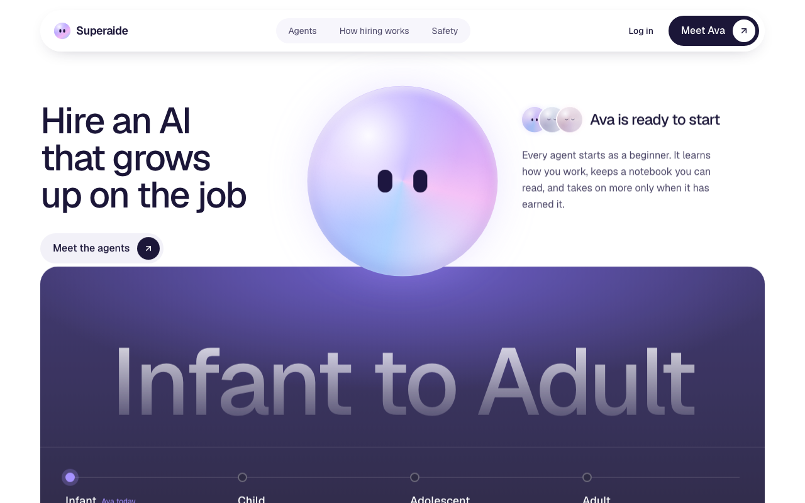
</p>

## Why Superaide

| | |
| --- | --- |
|  | **Earned autonomy.** Every agent starts as a beginner (Infant, then Child, Adolescent, Adult). It takes on more only when it has earned it, and side effects need your approval. |
|  | **Privacy decided in code.** Who someone is, what they may see and what may run are decided by code and the database. The model writes reply text and proposes an action; it never writes identity, trust or memory tables. |
|  | **Audience-scoped memory.** Every memory carries an audience, and the filter runs inside the SQL query, so something out of audience never reaches the prompt. |
|  | **A hard spend cap.** Each Claude call reserves its worst-case price first and is refused if it could pass the cap. Bring your own AI key (any provider), or opt in to capped Superaide credits. |
|  | **Reliability first.** Background work runs as retried jobs in Postgres, and failures are shown to the owner instead of swallowed. |
|  | **Many owners, one product.** Anyone can hire their own Ava. Each owner's data is isolated (tenant and instance ids on every row, Row-Level Security). |

## What it does

<table>
  <tr>
    <td width="50%">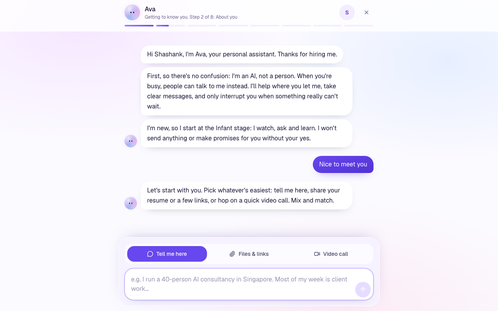<br/><b>An introduction, the way a new assistant would.</b> Eight short steps: about you, the people who matter, what is urgent, quiet hours, what may be shared, ground rules, connections.</td>
    <td width="50%">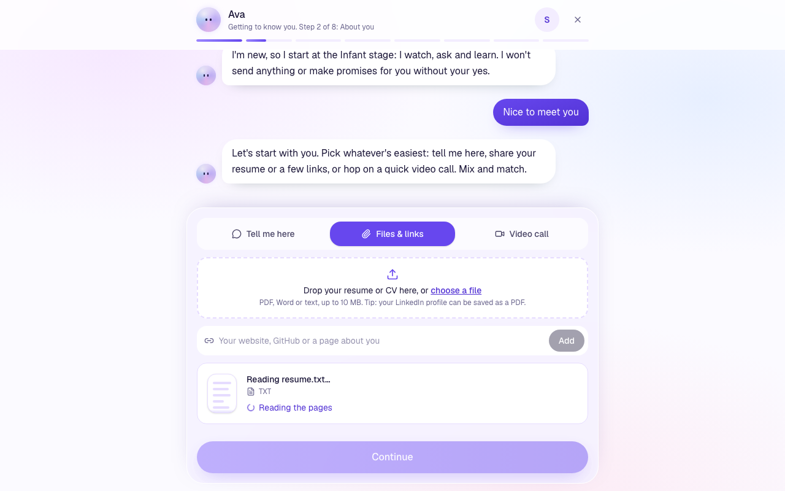<br/><b>Learn from a file, a link or a video call.</b> Facts keep their source. Removing a file removes what was learned from it.</td>
  </tr>
  <tr>
    <td>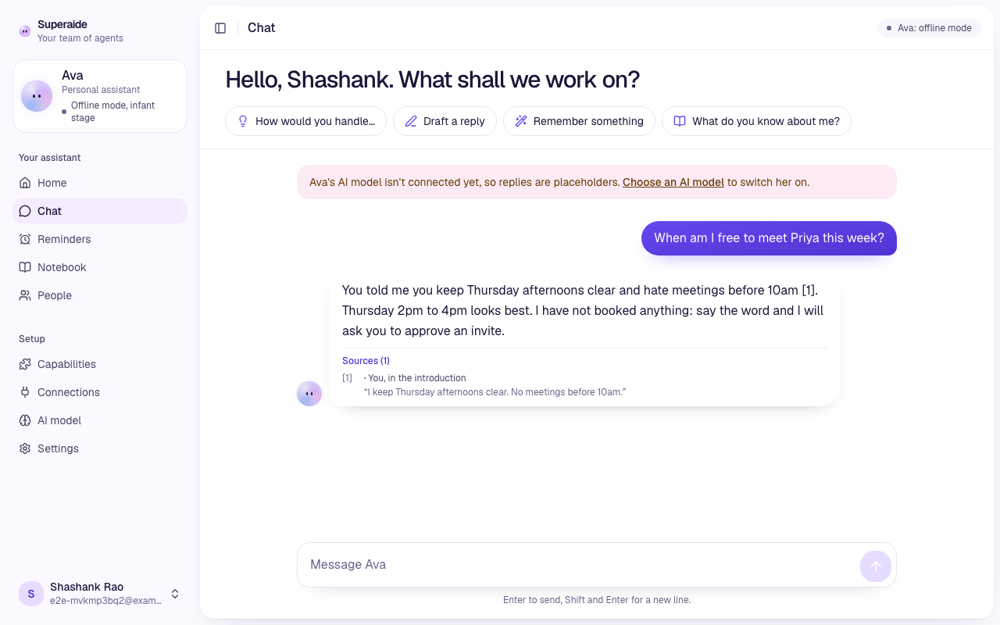<br/><b>Memory with sources.</b> An answer can cite the notebook entry it came from. (This capture is a mocked reply in offline mode; see the note below.)</td>
    <td>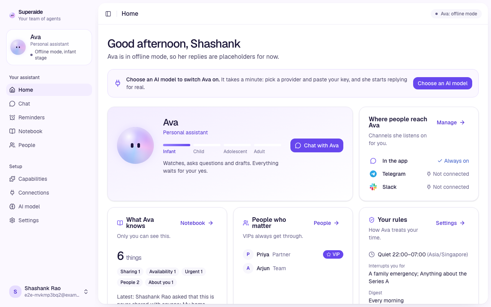<br/><b>Dashboard.</b> Her stage, where people reach her, what she knows, who always gets through and your rules.</td>
  </tr>
  <tr>
    <td>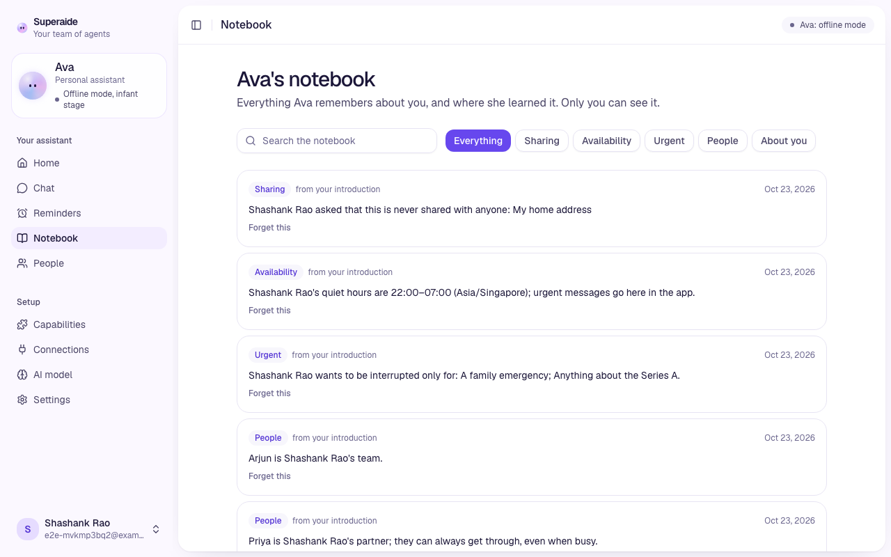<br/><b>A notebook you can read.</b> Each fact has a category and where it came from.</td>
    <td>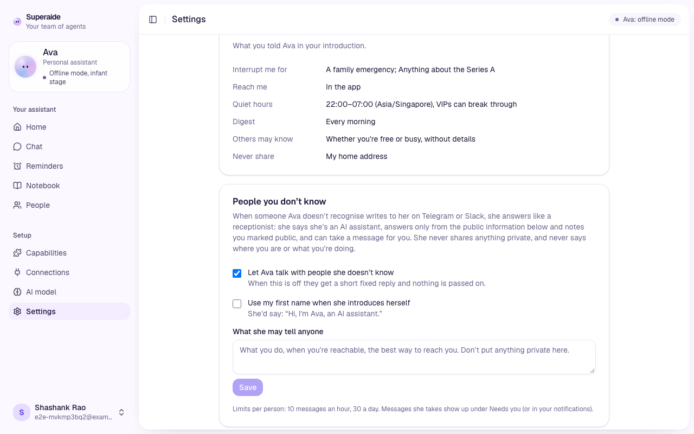<br/><b>A receptionist for strangers.</b> Unknown senders get a fixed reply, or a limited receptionist you switch on that shares only what you marked public.</td>
  </tr>
  <tr>
    <td>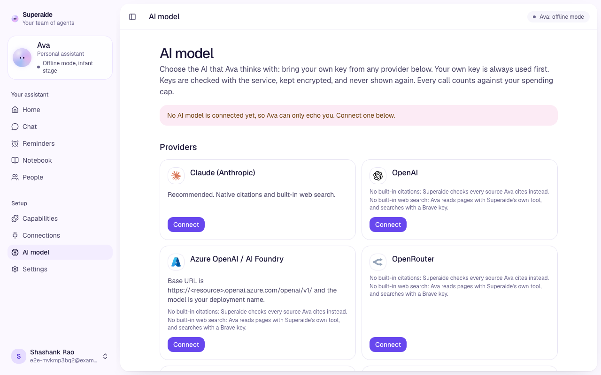<br/><b>Your AI, your key.</b> Pick a provider on the AI model page. Each key is checked with the service, encrypted and shown only as a hint.</td>
    <td>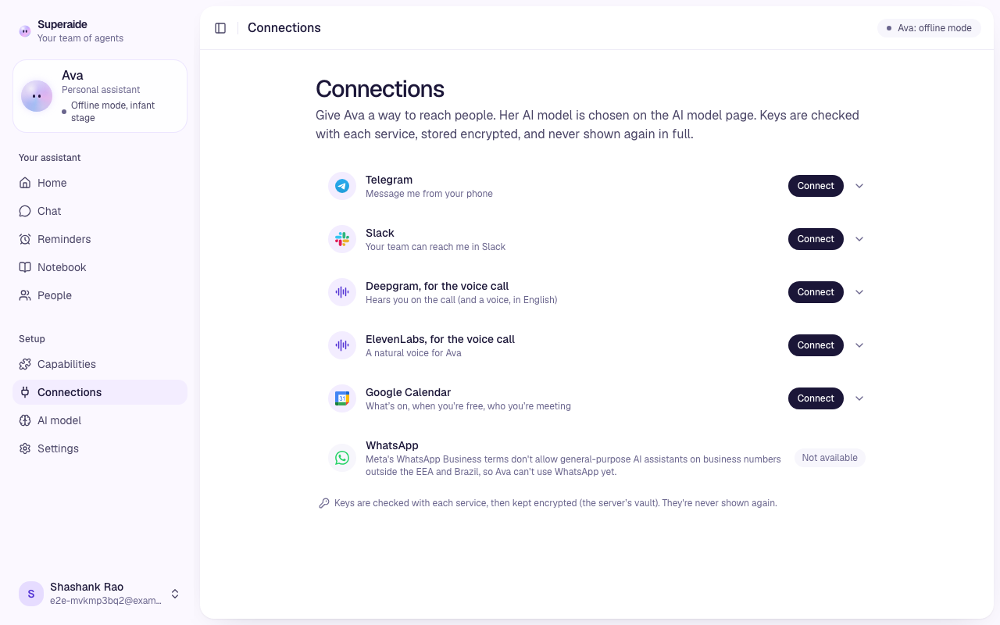<br/><b>Connections, in the app.</b> Telegram, Slack and Google Calendar, without editing files.</td>
  </tr>
  <tr>
    <td>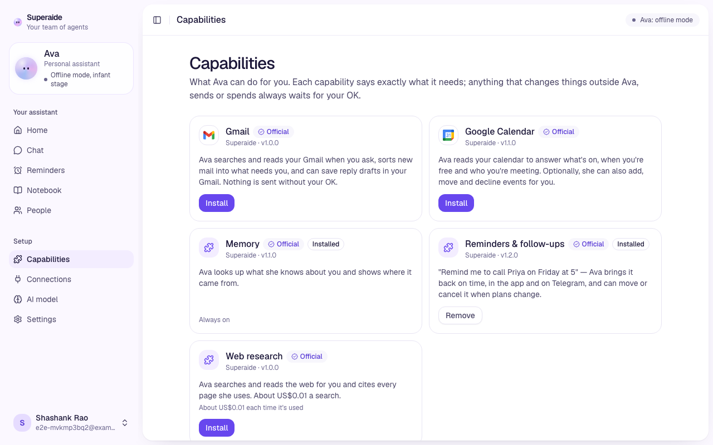<br/><b>Capabilities.</b> The skills Ava can use, and what each is allowed to do.</td>
    <td align="center">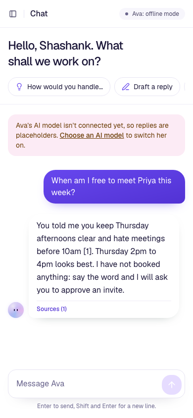 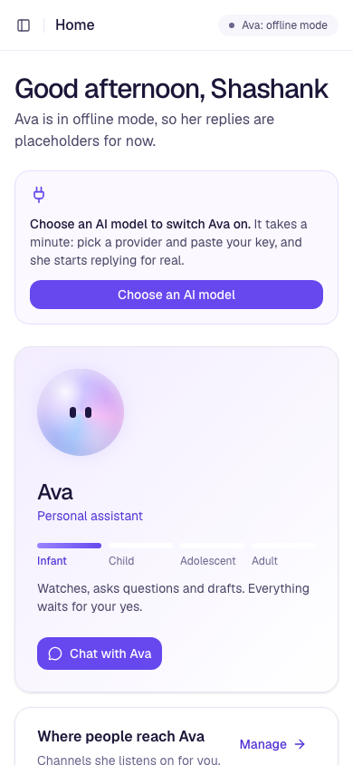<br/><b>Phone-sized screens</b> work too.</td>
  </tr>
</table>

All screenshots are taken from the running app with a fake test owner and the offline model (no real data, nothing spent). With no AI model connected Ava answers with placeholders; connect one on the **AI model** page to switch her on.

**Channels and identity**
- Telegram, Slack and the in-app web chat, normalised to one message type. Unverified webhooks and bad Slack signatures are dropped.
- People are recognised by immutable platform IDs, never display names. Unknown senders get stranger mode: a fixed reply, no memory, no model call (unless you switch the receptionist on).
- A new channel is linked only with a one-time code sent to a channel you already trust.

**Memory and knowledge**
- Typed settings (contacts, preferences) plus a notebook of sourced facts; the owner brief is scoped to who is asking.
- Reminders and approvals in the app; Google Calendar as a connection.
- Gmail inbox triage and the triage and escalation pipeline exist but are **off by default** (`GMAIL_TRIAGE_ENABLED`, `TRIAGE_ENABLED`, see [ADR 0010](docs/decisions/0010-triage-and-escalation.md)).
- A video-call introduction, where Ava speaks and your browser transcribes. A second voice pipeline (v2) is behind `VOICE_INTRO_V2`, off by default ([ADR 0012](docs/decisions/0012-voice-intro.md)).

**Operations**
- An operator console at `/console`: people and trust tiers, conversations, a safety log, spend, a pause switch and an impostor simulator.
- A kill switch that stops all model calls, and a CLI (`uv run superaide --help`).

## Quick start

**On a Mac, no setup:** double-click `start.command`, or run:

```bash
bash start.command
```

It installs [uv](https://docs.astral.sh/uv/) and, if Node.js 20.9+ is missing, a private checksum-verified Node in `.tools/`. It starts Postgres (Docker if installed, else an embedded one), then the API and the frontend, and opens http://localhost:3000. Without an AI key Ava runs in offline mode and nothing is spent. `--reset` wipes the data first; `--no-docker` forces the embedded Postgres.

**For development** you need [uv](https://docs.astral.sh/uv/), Node 24 (22 also works) and Docker:

```bash
make setup                         # backend, frontend and e2e dependencies, git hooks
cp backend/.env.example backend/.env
make db migrate                    # Postgres 17 + pgvector in Docker, then the tables
make api                           # terminal 1: API with auto-reload on :8000
make web                           # terminal 2: Next.js frontend on :3000
```

`make` lists every command, and `make stack` runs the whole stack in containers. To reach the app from a phone or through a tunnel (for example a Cloudflare quick tunnel), add the public address to `LINK_ORIGINS` (the example in [`backend/.env.example`](backend/.env.example) is `https://*.trycloudflare.com`) so links in emails use it. **On a server:** `sudo bash deploy/bootstrap.sh your-domain` puts the app on a VPS with HTTPS ([deploy/README.md](deploy/README.md)).

## How it works

Everything about **who** someone is, **what** they may see and **what** may run is decided in code. The model only writes reply text and proposes an action.

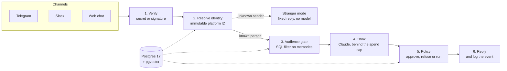

| Part | Stack | Runs on |
| --- | --- | --- |
| [`frontend/`](frontend) | Next.js 16 (App Router), React 19, Tailwind CSS 4, Motion | http://localhost:3000 |
| [`backend/`](backend) | Python 3.14, FastAPI (JSON only), SQLAlchemy 2, Alembic, Claude | http://127.0.0.1:8000 (`/docs`) |
| Database | Postgres 17 with pgvector | localhost:5432 |

The browser talks only to the Next.js server, which forwards `/api/*` to FastAPI, so the session cookie always belongs to the app's own origin ([ADR 0005](docs/decisions/0005-nextjs-frontend-and-api-proxy.md)). Telegram and Slack connect to the backend directly. More in [docs/architecture.md](docs/architecture.md).

## Safety model

| Decided in code (never by the model) | Decided by the model |
| --- | --- |
| Who someone is (platform ID lookup) and their trust tier | The wording of a reply |
| Which memories the sender may see (SQL audience filter) | Which action to propose, if any |
| Whether an action runs, needs approval or is refused | A short prediction attached to the turn |
| How much may be spent, and the kill switch | Which facts to extract from a file you share |
| Linking a new channel (one-time code to a trusted channel) | |

- Credentials are verified with their service, encrypted with AES-256-GCM and shown only as hints.
- Accounts use Argon2id, httpOnly cookie sessions, CSRF protection, lockouts and an audit trail.
- New features ship behind flags that default to **off** (see the `*_ENABLED` settings in `backend/.env.example`).
- The impostor scenarios live in `backend/tests/redteam`. Report vulnerabilities as described in [SECURITY.md](SECURITY.md).

## Configuration

The backend reads `backend/.env` (see [`backend/.env.example`](backend/.env.example)). Credentials connected in the app override `.env` values.

| Variable | Purpose |
| --- | --- |
| `DATABASE_URL` / `TEST_DATABASE_URL` | Postgres for the app and for tests (the tests wipe theirs) |
| `MAX_SPEND_USD` | Hard cap on Claude API spend (default 10) |
| `ANTHROPIC_API_KEY`, `TELEGRAM_BOT_TOKEN`, `SLACK_*` | Optional; prefer connecting them in the app |
| `PLATFORM_AI_ENABLED` | Opt-in capped Superaide credits (off by default) |
| `ADMIN_TOKEN` | Operator console access |
| `FRONTEND_ORIGIN`, `LINK_ORIGINS` | The browser origin the API accepts; origins allowed in email links |
| `SESSION_COOKIE_SECURE` | Set `true` when served over HTTPS |
| `TRIAGE_ENABLED`, `GMAIL_TRIAGE_ENABLED`, `ASK_LINK_ENABLED`, `PUSH_ENABLED` | Feature flags, all off by default |

## Tech stack

Backend: Python 3.14 with uv, FastAPI, SQLAlchemy 2, Alembic, Argon2, Anthropic Claude (Haiku for the small jobs), pgvector. Frontend: Next.js 16, React 19, Tailwind CSS 4, Motion, Axios. Tests: pytest, Playwright. Tooling: Ruff, mypy, oxlint, pre-commit, GitHub Actions, Docker Compose, Caddy for HTTPS.

## Project layout

```text
backend/
  src/superaide/
    pipeline.py      verify, resolve, audience gate, think, policy, reply
    app/  auth/      the app API; accounts, passwords, sessions, rate limits
    identity/        resolver, linking codes, trust tiers
    context/         the audience gate (a SQL filter)
    knowledge/       extraction from files and links, facts, people, preferences
    memory/          episodic log and audience-tagged memories
    brain/           Claude client, pricing, spend ledger, prompts, the agent charter
    policy/          action rules, kill switch
    channels/        Telegram and Slack adapters, signature checks
    skills/          calendar and Gmail skills, manifest and registry
    triage/ reception/ voice/ push/ ...   feature areas, mostly behind flags
    vault/           encrypted credentials and checks against each service
    api/             admin API for the operator console
  alembic/           database migrations
  tests/             pytest against a real Postgres; tests/redteam has the impostor scenarios
  evals/             scenario evals and the memory regression gate
frontend/src/        app (routes), features (screens), components, lib, proxy.ts
e2e/                 Playwright tests on isolated stacks (slots)
deploy/              VPS guide, bootstrap and backup scripts, Caddy image
docs/                architecture, decisions (ADRs), research
```

## Development

```bash
make check      # lint, types, backend tests, frontend build (what CI runs, minus e2e)
make e2e        # browser tests on an isolated stack; E2E_SLOT=n for another slot
make eval       # scenario evals, offline with a fake model, free
make eval-gate  # long-term-memory regression gate, offline and free
```

Tests need a running Postgres and never call the real API (`FAKE_LLM`). `make eval-live` and `make eval-ltm-live` use the real model and cost a few cents with a hard cap. CLI commands (run from `backend/` with `uv run superaide <command>`): `serve`, `reset-password`, `freeze`/`unfreeze`, `spend`, `hello`, `add-manager`/`add-colleague`/`unlink`, `telegram-poll`/`slack-socket`.

## Documentation

| Where | What |
| --- | --- |
| [docs/architecture.md](docs/architecture.md) | Request paths, data, where knowledge comes from, credentials |
| [ADR 0001 to 0004](docs/decisions) | Monorepo, Postgres as the only store, cookie sessions and CSRF, the credentials vault |
| [ADR 0005](docs/decisions/0005-nextjs-frontend-and-api-proxy.md), [0006](docs/decisions/0006-skill-protocol.md), [0007](docs/decisions/0007-pluggable-providers.md) | Next.js and the API proxy, the skill protocol, pluggable AI providers |
| [ADR 0008](docs/decisions/0008-one-ava-across-channels.md), [0009](docs/decisions/0009-many-owners-one-ava.md) | One Ava across channels, many owners |
| [ADR 0010](docs/decisions/0010-triage-and-escalation.md), [0011](docs/decisions/0011-mobile.md), [0012](docs/decisions/0012-voice-intro.md) | Triage and escalation, mobile (proposed), the voice introduction |
| [docs/research](docs/research) | Research notes behind the design, e.g. [memory architecture](docs/research/Personal%20assistant%20memory%20architecture.md) |
| [CHANGELOG.md](CHANGELOG.md), [deploy/README.md](deploy/README.md), [e2e/README.md](e2e/README.md) | What changed, running on a server, the browser tests |

## Roadmap

Honest and incomplete; the open [issues](https://github.com/BeastxD7/superaide/issues) are the source of truth.

- **Built, flag off:** triage and escalation ([ADR 0010](docs/decisions/0010-triage-and-escalation.md)), Gmail inbox triage, the "Ask my Ava" public link, voice introduction v2, web push, and several safety experiments (second opinion, relationship safety, skill ratchet, overnight tuner, echo filter).
- **Memory ([#47](https://github.com/BeastxD7/superaide/issues/47) to [#51](https://github.com/BeastxD7/superaide/issues/51)):** document chunks, real erasure, importance and decay, episodes with a nightly "sleep" job, and a long-term-memory eval set.
- **Trust and audit ([#110](https://github.com/BeastxD7/superaide/issues/110) to [#116](https://github.com/BeastxD7/superaide/issues/116)):** approvals bound to the exact payload, narrowing delegation keys, a hash-chained action log, pinned tool manifests.
- **Ideas, not started:** a visual notebook map ([#55](https://github.com/BeastxD7/superaide/issues/55)), a memory passport ([#56](https://github.com/BeastxD7/superaide/issues/56)), a read-only memory endpoint for other assistants ([#138](https://github.com/BeastxD7/superaide/issues/138)), importing from other assistants ([#141](https://github.com/BeastxD7/superaide/issues/141)), a skill marketplace ([#129](https://github.com/BeastxD7/superaide/issues/129) to [#132](https://github.com/BeastxD7/superaide/issues/132)). The overview is [#142](https://github.com/BeastxD7/superaide/issues/142).
- **Owner decisions pending:** pricing, public listing and paid creators are not decided and nothing here promises them.

## Contributing

Read [CONTRIBUTING.md](CONTRIBUTING.md), [SECURITY.md](SECURITY.md), [SUPPORT.md](SUPPORT.md) and the [Code of Conduct](CODE_OF_CONDUCT.md). Every change is a pull request from a branch off `main`. The PR template asks for the security and privacy checklist, spend impact, feature flags (new ones default to off), a rollback plan and **before and after screenshots for any change you can see**. Use fake data in tests and screenshots, never real keys or personal details.

## Acknowledgements

The shape of this README borrows from [Docling](https://github.com/docling-project/docling). Superaide stands on [FastAPI](https://fastapi.tiangolo.com/), [SQLAlchemy](https://www.sqlalchemy.org/), [Alembic](https://alembic.sqlalchemy.org/), [Next.js](https://nextjs.org/), [React](https://react.dev/), [Tailwind CSS](https://tailwindcss.com/), [Motion](https://motion.dev/), [Playwright](https://playwright.dev/), [Postgres](https://www.postgresql.org/) with [pgvector](https://github.com/pgvector/pgvector), [uv](https://docs.astral.sh/uv/), [Ruff](https://docs.astral.sh/ruff/) and [Claude](https://www.anthropic.com/claude).

## License

Proprietary. All rights reserved. The repository is public to read, but there is no `LICENSE` file granting reuse rights.
<!-- probe -->
