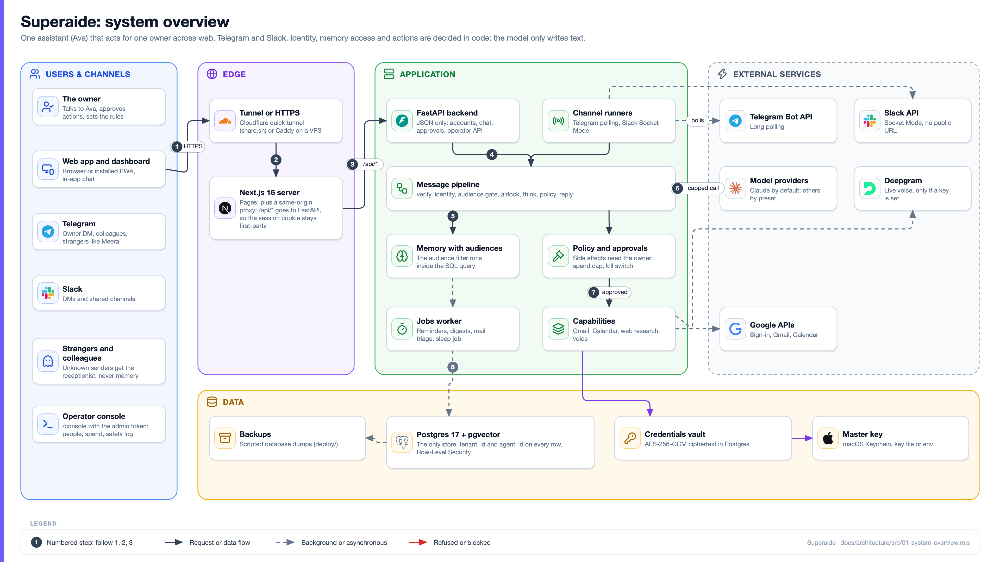

<p align="center">
  
</p>

<p align="center">
  <a href="https://github.com/BeastxD7/superaide/actions/workflows/ci.yml"></a>
  
  
  
  
  
  
  
</p>

# Superaide

**An AI assistant you hire, who answers the people who reach you on web, Telegram and Slack, and asks before she does anything that matters.** The first one is **Ava**. She starts as an apprentice: she watches, asks and learns, and nothing she does reaches anyone else without your approval.

<p align="center">
  
</p>

## What it does

- **One assistant across channels.** The in-app web chat, Telegram and Slack, recognised by immutable platform ids, never by display names.
- **One memory, with audience rules.** What Ava learns from you is shared across your own channels. Every note carries an audience, and the filter runs inside the SQL query, so private notes never reach a shared channel or a stranger.
- **Approvals before anything is sent.** The model only proposes. Sending an email or changing your calendar needs your tap, bound to the exact content you saw.
- **Gmail, Calendar and the web.** Read and draft mail, send with approval and an honest AI signature, manage events, research with citations, set reminders, talk by voice.
- **A receptionist for strangers.** Unknown senders get a short, tool-free reply from public facts only; what they say becomes a message for you.
- **A hard spend cap.** Each model call reserves its worst-case cost first and is refused if it could pass your limit. Bring your own key, any provider.
- **Privacy by design.** Postgres Row-Level Security per owner, credentials encrypted with AES-256-GCM, other people's contact details swapped for placeholders before a model call.
- **Earned autonomy.** Narrow, signed, revocable mandates let her do named small things without asking, never sending or spending.

## How it works

Everything about **who** someone is, **what** they may see and **what** may run is decided in code. The model writes reply text and proposes an action. Every message takes the same path: verify, resolve identity, audience gate, airlock, think, policy, reply. The browser talks only to Next.js, which forwards `/api/*` to FastAPI so the session cookie stays first-party; Telegram and Slack connect outward from the backend. Postgres 17 with pgvector is the only store.



The full tour, with ten more diagrams and code pointers, is in [ARCHITECTURE.md](ARCHITECTURE.md).

## Quick start

**One command (Mac):** `bash start.command` installs uv (and a private Node if needed), starts Postgres (Docker, or an embedded one), the API and the frontend, and opens http://localhost:3000. Without an AI key Ava runs offline and nothing is spent. `--reset` wipes the data; `--no-docker` forces the embedded Postgres.

**Share it from your Mac:** `bash share.sh` (needs `brew install cloudflared`) opens a free Cloudflare quick tunnel and prints a public link. See `bash share.sh --help` for a fixed hostname and Google sign-in.

**For development** (uv, Node 24 and Docker):

```bash
make setup                         # backend, frontend and e2e dependencies, git hooks
cp backend/.env.example backend/.env
make db migrate                    # Postgres 17 + pgvector in Docker, then the tables
make api                           # terminal 1: API on http://127.0.0.1:8000 (docs at /docs)
make web                           # terminal 2: Next.js on http://localhost:3000
```

`make` lists every command; `make check` runs what CI runs (minus e2e). On a server: `sudo bash deploy/bootstrap.sh your-domain` ([deploy/README.md](deploy/README.md)). Every setting is documented in [docs/configuration.md](docs/configuration.md).

## Documentation

| Where | What |
| --- | --- |
| [ARCHITECTURE.md](ARCHITECTURE.md) | The product and the whole system, with 11 diagrams |
| [docs/architecture.md](docs/architecture.md) | A shorter request-path and data reference |
| [docs/configuration.md](docs/configuration.md) | Every environment variable and feature flag, set-up steps for Google, Telegram, Slack, email |
| [docs/settings.md](docs/settings.md) | What each owner-facing setting does |
| [docs/decisions/](docs/decisions) | Architecture decision records (ADRs) |
| [docs/research/](docs/research) | Research behind memory, safety and identity |
| [docs/design/](docs/design) | Design notes: dashboard, console, mobile, test modules |
| [docs/principal-card.md](docs/principal-card.md) | The honest AI signature on outgoing mail |
| [docs/voice.md](docs/voice.md), [docs/memory-passport.md](docs/memory-passport.md) | Voice, and the memory passport |
| [deploy/README.md](deploy/README.md) | Running on a VPS with HTTPS and backups |
| [CONTRIBUTING.md](CONTRIBUTING.md), [AGENTS.md](AGENTS.md), [CLAUDE.md](CLAUDE.md) | How to contribute, rules for AI agents, architecture notes for Claude Code |
| [e2e/README.md](e2e/README.md), [CHANGELOG.md](CHANGELOG.md) | Browser tests, what changed |
| [SECURITY.md](SECURITY.md), [SUPPORT.md](SUPPORT.md), [CODE_OF_CONDUCT.md](CODE_OF_CONDUCT.md) | Reporting, help, conduct |

## Tech stack

<p>
  
  
  
  
  
  
  
  
  
  
  
  
</p>

Also: Alembic, Argon2, Deepgram (voice), Telegram and Slack APIs, Google APIs, uv, Ruff, mypy, oxlint, GitHub Actions. Versions are in `backend/pyproject.toml` and `frontend/package.json`.

## Project layout

Package by feature ([ADR 0015](docs/decisions/0015-project-layout.md)):

```text
backend/
  src/superaide/
    pipeline.py       verify, resolve, audience gate, think, policy, reply
    platform/         config, db (models, RLS), audit, tenancy, security
    app/ auth/        the app API; accounts, sessions, onboarding
    identity/ context/ memory/ knowledge/   people, the audience gate, notes, facts
    brain/ policy/ mandate/                 model client and spend cap, approvals, mandates
    channels/ integrations/ skills/ tools/  Telegram and Slack, Gmail and Calendar, capabilities
    reception/ triage/ proactive/ jobs/     receptionist, escalation, digests, the job queue
    features/         optional features (voice, push, school, ...)
    vault/ api/       encrypted credentials; operator API
  alembic/ tests/ evals/
frontend/src/         app (routes), features (screens), components, lib
e2e/                  Playwright tests on isolated stacks
deploy/ ci/ scripts/  VPS stack, CI module map, repo tooling
docs/                 ADRs, research, design notes, diagrams (docs/architecture)
```

## Contributing

Read [CONTRIBUTING.md](CONTRIBUTING.md) first; AI agents also follow [AGENTS.md](AGENTS.md). Every change is a pull request from a branch off `main` with tests, before and after screenshots for visible changes, and fake data only.

## License

Proprietary. All rights reserved. The repository is public to read, but there is no `LICENSE` file granting reuse rights.
